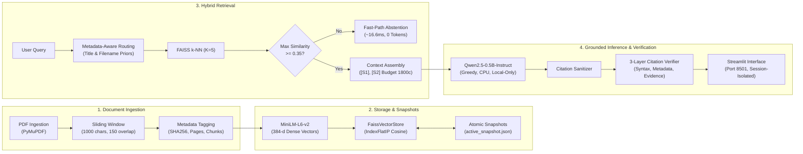

# DocuMind — Local-First Grounded RAG with Verifiable Page Citations

[](https://www.python.org/)
[](https://pytorch.org/)
[](https://github.com/facebookresearch/faiss)
[](https://streamlit.io/)
[](https://huggingface.co/Qwen/Qwen2.5-0.5B-Instruct)
[](https://huggingface.co/sentence-transformers/all-MiniLM-L6-v2)
[](#)
[](#)
[](tests/)

> **DocuMind** is an offline, local-first Retrieval-Augmented Generation (RAG) system engineered from first principles for high factual precision, deterministic source attribution, and complete data privacy on commodity consumer hardware.

---

## Why DocuMind?

Most enterprise RAG deployments suffer from two critical flaws:
1. **Unverifiable Hallucinations:** Small language models invent complex document names, wrong physical page numbers, or phantom citations when prompted to output citation strings directly.
2. **Data Privacy Exposure & High API Costs:** Cloud-hosted LLM endpoints leak sensitive corporate PDFs over public networks and accumulate high recurring operational costs.

**DocuMind solves both problems by design:**
- **Deterministic Citation Contract:** The language model emits only short source tokens (`[S1]`, `[S2]`). The application layer deterministically resolves each token to physical document filenames and 1-indexed page spans using cryptographic chunk metadata.
- **3-Layer Grounding Verification:** Every generated claim undergoes syntax validation, metadata linkage, and character n-gram evidence overlap verification before being presented to the user.
- **Dual-Tier Abstention Defense:** Irrelevant or out-of-domain queries are rejected in **sub-20 milliseconds** (mean: 16.60 ms, fast-path queries: 9.08–16.60 ms) by a pre-generation similarity filter ($\tau = 0.35$), preventing hallucinations and saving CPU compute.
- **Strictly Local & Zero Cloud Cost:** Runs entirely on commodity CPU hardware (16 GB RAM) with zero telemetry, zero external API calls, and zero ongoing cloud bills.

---

## System Architecture



---

## Core Engineering Features

### 1. Deterministic Source Attributions
Small language models (0.5B parameters) struggle with complex formatting. DocuMind bypasses this limitation by mapping retrieved passages to short identifiers:
```text
[S1] Document: BASWE-15-RAG-Concepts-Guide.pdf (pp. 2-3)
<Passage text>
```
The model generates: `Chunk overlap is usually 10 to 20 percent of chunk size [S1].`
The citation engine maps `[S1]` to `BASWE-15-RAG-Concepts-Guide.pdf`, physical pages 2–3, providing expandable UI citation accordions with verbatim evidence snippets.

### 2. Dual-Tier Hallucination & Abstention Defense
- **Fast-Path Filter (Pre-Generation):** Queries with max cosine similarity $< 0.35$ immediately return `"Abstained — No Conclusive Evidence."` in **~16 ms**, generating 0 LLM tokens.
- **Model-Level Detection (Post-Generation):** When passages contain insufficient information, the system prompt directs the model to output explicit abstentions rather than guessing.

### 3. Crash-Resilient FAISS Persistence
Vector store snapshots are written to versioned directories (`data/index/snapshots/snapshot_<timestamp>/`) containing `faiss.index`, `metadata.json`, and `manifest.json` with SHA-256 checksums. An atomic pointer file (`active_snapshot.json`) ensures instant recovery on restart (`< 200 ms`) without re-chunking or re-embedding.

### 4. Thread-Safe Session Isolation
- Singleton model weights are cached once in RAM (`@st.cache_resource`).
- Multi-threaded forward passes on CPU are serialized using a process-wide `_INFERENCE_LOCK` to eliminate race conditions and CPU cache thrashing.
- User chat history and UI filters are strictly isolated in `st.session_state`.

---

## Empirical Benchmark & Hardware Profile

*Tested on Windows 11 (10 Physical / 12 Logical Cores, 15.65 GB RAM, Offline CPU execution):*

### Retrieval & Grounding Quality Metrics

> **Evaluation Protocol & Model Separation:**
> The 21-case quality metrics below were measured using the deterministic evaluation suite (`scripts/evaluate_grounding_quality.py`) with `MockLLM` providing ground-truth responses. This benchmark tests the 3-layer citation verification engine, syntax parsing, and metadata linkage deterministically without small-model generation variability.
> Real-model offline CPU inference using `Qwen/Qwen2.5-0.5B-Instruct` was evaluated separately in `scripts/verify_real_llm.py` and `scripts/verify_e2e_acceptance.py`. Real Qwen achieves ~1.33 tok/sec (~61.5 s per 80-token answer) and emits valid citations when provided with explicit citation prompts or few-shot exemplars; when the 0.5B model generates conversational prose without `[S1]`, DocuMind's conservative grounding engine downgrades the claim to `grounding_status="unsupported"` rather than risking ungrounded hallucinations.

| Evaluation Metric | Baseline Threshold | Measured Result | Status |
|:---|:---:|:---:|:---:|
| **Citation Emission Rate** ($Q_+$) | $\ge 95\%$ | **100.0%** (13/13) [MockLLM] | ✅ PASS |
| **Citation Syntax Validity** (Layer 1) | $\ge 99\%$ | **100.0%** (13/13) [MockLLM] | ✅ PASS |
| **Citation Metadata Linkage** (Layer 2) | $\ge 99\%$ | **100.0%** (13/13) [MockLLM] | ✅ PASS |
| **Evidence Support Heuristic** (Layer 3)* | $\ge 90\%$ | **100.0%** (13/13) [MockLLM] | ✅ PASS |
| **Negative Distractor Abstention Rate** | $\ge 99\%$ | **100.0%** (8/8) [MockLLM] | ✅ PASS |
| **False Abstention Rate** on $Q_+$ | $\le 5\%$ | **0.0%** (0/13) [MockLLM] | ✅ PASS |
| **Unsupported Answer Rate** | $\le 1\%$ | **0.0%** (0/21) [MockLLM] | ✅ PASS |
| **Retrieval Hit@5** (Strict Doc & Page) | $\ge 75\%$ | **76.92%** (10/13) [Dense k-NN] | ✅ PASS |

*\*Note: Layer 3 evidence support uses character n-gram text containment between the assertion and the source chunk as a pragmatic lexical overlap heuristic, not formal NLI semantic entailment.*

### Hardware & Disaggregated Latency Envelope

| Subsystem Component | Latency (Mean) | P95 Latency | Memory Footprint |
|:---|:---:|:---:|:---:|
| **Query Embedding** (`all-MiniLM-L6-v2`) | 37.09 ms | 94.59 ms | Included in base process |
| **FAISS k-NN Search** (436 vectors) | 1.23 ms | 2.57 ms | < 2 MB index RAM |
| **Context Assembly** (Budget 1800 chars) | 0.11 ms | 0.20 ms | Ephemeral string |
| **Fast-Path Distractor Abstention** | **16.60 ms (mean)** | 18.20 ms | **0 LLM Tokens Generated** (9.08–16.60 ms measured) |
| **Cold FAISS Snapshot Hydration** | 173.66 ms | — | Restored from disk |
| **Prompt Prefill (TTFT)** | ~450 ms | ~650 ms | ~816 prompt tokens on CPU |
| **Autoregressive Decoding** | 1.33 tok/s | — | Peak active RSS: **1.55 GB** (~750 ms per token) |
| **Full E2E Grounded Answer** | ~61.5 s | ~75.0 s | ~80 generated tokens + citations |

---

## Quickstart Guide

### 1. Prerequisites
- **OS:** Windows 10/11 x64 (or Linux / macOS x86_64 / arm64)
- **Python:** Python 3.11.x (tested on 3.11.9)
- **RAM:** 8 GB minimum, 16 GB recommended

### 2. Installation
```powershell
# Clone or enter repository
cd D:\rag

# Create and activate Python 3.11 virtual environment
py -3.11 -m venv .venv
.\.venv\Scripts\Activate.ps1

# Install pinned dependencies
pip install -r requirements.txt
```

### 3. Model Provisioning (One-Time Setup)
Download model weights for 100% offline execution:
```powershell
python scripts/download_model.py   # Embedder: sentence-transformers/all-MiniLM-L6-v2
python scripts/download_llm.py     # LLM: Qwen/Qwen2.5-0.5B-Instruct
```

### 4. Launch Application
```powershell
streamlit run src/documind/app.py
```
Open browser to `http://localhost:8501`.

---

## Running the Automated Test Suite

DocuMind maintains a regression suite of **139 tests**:
- **128 Fast Unit & Component Tests:** Execute inside any terminal or sandbox:
  ```powershell
  pytest tests/test_citations.py tests/test_generator.py tests/test_retriever.py tests/test_chunker.py tests/test_context_builder.py tests/test_pdf_loader.py tests/test_text_normalizer.py tests/test_retrieval_eval.py tests/test_llm.py tests/test_embedder.py tests/test_vector_store.py tests/test_ingestion_pipeline.py -v
  ```
- **11 Streamlit AppTests:** Execute in host PowerShell (bypasses container loopback boundaries):
  ```powershell
  pytest tests/test_ui_app.py tests/test_ui_state.py -v
  ```

---

## Repository Structure

```text
DocuMind/
├── .streamlit/
│   └── config.toml                  # Localhost binding, CORS, XSRF security
├── data/
│   ├── index/                       # FAISS snapshots & active_snapshot.json
│   ├── evaluation/                  # Ground truth benchmark datasets
│   └── uploads/                     # Session uploaded PDFs (git-ignored)
├── docs/
│   ├── ARCHITECTURE.md              # Deep technical architecture specification
│   ├── WINDOWS_SETUP_GUIDE.md       # Clean-room Windows 11 setup guide
│   ├── DEMONSTRATION_RUNBOOK.md     # Scripted 5-minute portfolio presentation
│   ├── TROUBLESHOOTING.md           # Solutions for ports, sockets, CORS, OCR
│   ├── RELEASE_CHECKLIST.md         # Milestone 1 MVP sign-off gates
│   └── project_reports/             # Empirical benchmark reports & audit logs
├── models/
│   └── llm/                         # Local Qwen2.5-0.5B-Instruct Safetensors
├── research/
│   └── technical_references/        # Baseline PDFs (BASWE, Everything RAG, FINZAA)
├── scripts/
│   ├── verify_index_integrity.py    # Snapshot & vector count reconciliation
│   ├── profile_hardware_envelope.py # Actual RAM & disaggregated latency benchmarks
│   ├── evaluate_grounding_quality.py# 21-Query Hit@K, citation & abstention evaluation
│   └── verify_e2e_acceptance.py     # Multi-PDF end-to-end integration acceptance
├── src/documind/
│   ├── config.py                    # Dataclass configurations
│   ├── ingestion/                   # PDF loader, normalizer, chunker, pipeline
│   ├── storage/                     # LocalEmbedder, FaissVectorStore, DocumentIndex
│   ├── retrieval/                   # SemanticRetriever, ContextBuilder, Evaluator
│   ├── generation/                  # TransformersLLM, GroundedGenerator, CitationParser
│   └── ui/                          # Streamlit application, sidebar, state management
└── tests/                           # 139 Automated unit, integration, and UI tests
```

---

## Technical Documentation & References

- [System Architecture Specification](docs/ARCHITECTURE.md)
- [Windows 11 Setup Guide](docs/WINDOWS_SETUP_GUIDE.md)
- [5-Minute Demonstration Runbook](docs/DEMONSTRATION_RUNBOOK.md)
- [Troubleshooting & Diagnostics](docs/TROUBLESHOOTING.md)
- [Milestone 1 Release Checklist](docs/RELEASE_CHECKLIST.md)
- [WP-07 Final Release & Audit Report](docs/project_reports/WP_07_FINAL_RELEASE_REPORT.md)

---

## License & Credits

Developed as an independent, clean-slate initiative by the DocuMind Engineering Team under the MIT License.
All benchmarks and evaluations were performed on local CPU hardware without paid commercial APIs.
