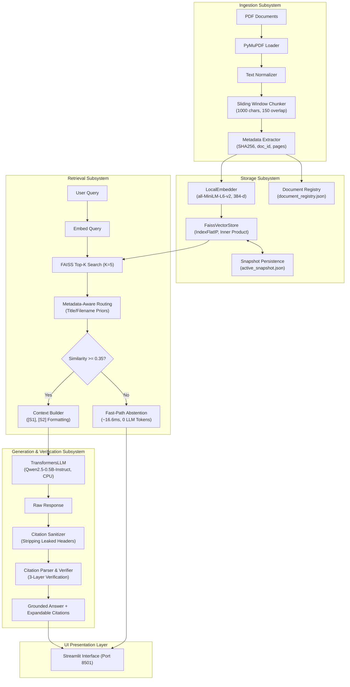
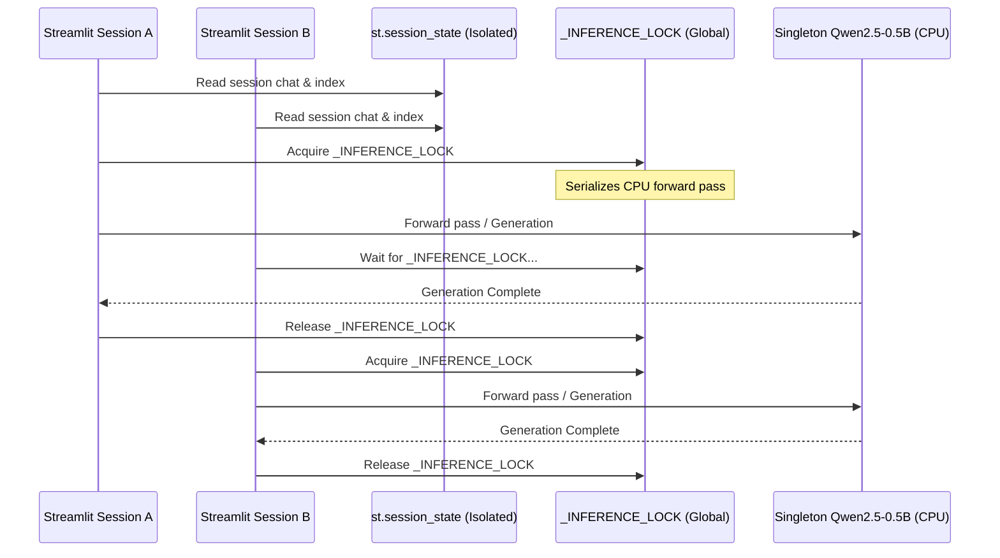

# DocuMind Architecture Specification

## 1. System Overview & Design Philosophy

DocuMind is an offline, local-first Retrieval-Augmented Generation (RAG) system engineered from first principles for high factual precision, deterministic source attribution, and complete data privacy on commodity consumer hardware.

### Core Architectural Principles

1. **Strict Offline Privacy Boundary:**
   - 100% local CPU execution. Zero telemetry, zero external API calls, zero cloud dependencies.
   - Fully reproducible under a **₹0 / $0 cloud compute budget**.

2. **Deterministic Citation Integrity:**
   - Small language models (e.g. 0.5B parameters) hallucinate when tasked with outputting verbose file paths, complex titles, or arbitrary metadata strings.
   - DocuMind enforces a **deterministic source token contract** (`[S1]`, `[S2]`). The model is instructed only to emit these short tokens. The application layer resolves tokens back to verified document filenames and physical page numbers via cryptographic chunk metadata.

3. **Dual-Tier Hallucination & Abstention Defense:**
   - **Tier 1 (Sub-20ms Fast-Path Filter):** Pre-generation cosine similarity threshold check ($\tau = 0.35$). If no retrieved passages exceed $\tau$, generation is short-circuited immediately (mean: 16.60 ms, individual queries: 9.08–16.60 ms)—saving seconds of CPU compute and preventing hallucination.
   - **Tier 2 (Post-Generation 3-Layer Validation):** Regex token extraction, metadata resolution, and lexical evidence n-gram overlap check (heuristic text containment rather than formal NLI semantic entailment). Answers with ungrounded citations or unsupported claims are rejected or flagged.

4. **Crash-Consistent Persistence:**
   - FAISS vector store snapshots are versioned and immutable (`snapshots/snap_<timestamp>/`). An atomic pointer file (`active_snapshot.json`) guarantees ACID-like recovery across application restarts.

5. **Resource Bounded for Consumer Hardware:**
   - Designed to run comfortably within a **16 GB RAM** hardware envelope (measured peak active inference RSS is **~1.55 GB**).

---

## 2. High-Level Subsystem Architecture



---

## 3. Subsystem Specifications & Contracts

### 3.1 Ingestion Subsystem (`documind.ingestion`)
- **Loader (`pdf_loader.py`):** Uses PyMuPDF (`fitz`) for fast, robust extraction of digital text, physical page boundaries, and document metadata.
- **Normalizer (`text_normalizer.py`):** Strips control characters, normalizes Unicode whitespace, standardizes hyphens/quotes, and eliminates redundant empty lines while preserving layout paragraph breaks.
- **Chunker (`chunker.py`):** Implements a character-bounded sliding window (`chunk_size=1000`, `chunk_overlap=150`). Boundaries respect sentence terminators (`.`, `?`, `!`, `\n\n`) to prevent splitting sentences.
- **Metadata Preserved per Chunk:**
  - `chunk_id`: Hierarchical deterministic ID (`doc_id_c0000`, `doc_id_c0001`, ...).
  - `doc_id`: SHA-256 digest of document content (first 16 hex chars).
  - `document_title` / `filename`: Source PDF filename.
  - `page_start` / `page_end`: Physical 1-indexed page boundaries spanned by the chunk.
  - `char_start` / `char_end`: Document-level character offsets.

### 3.2 Storage Subsystem (`documind.storage`)
- **Embedder (`embedder.py`):** `sentence-transformers/all-MiniLM-L6-v2` producing normalized 384-dimensional dense vectors.
  - Runtime: Torch CPU inference with PyTorch intra-op parallelism (`num_threads=8`).
  - Unit Test Mocking: `MockEmbedder` provides deterministic, zero-overhead L2-normalized vectors to prevent out-of-memory errors in automated suites.
- **Vector Store (`vector_store.py`):** `faiss.IndexFlatIP` (Exact Maximum Inner Product search). Since vectors are L2-normalized during embedding, inner product is strictly equivalent to cosine similarity.
- **Persistence Protocol (`FaissVectorStore.save` / `load`):**
  - Writes `faiss.index`, `metadata.json`, and `manifest.json` into a versioned subdirectory: `data/index/snapshots/snapshot_<timestamp>/`.
  - Atomically writes `data/index/active_snapshot.json` referencing the active snapshot directory and SHA-256 checksums.
  - On crash or reboot, `load()` reads the active pointer and validates file integrity.

### 3.3 Retrieval Subsystem (`documind.retrieval`)
- **Semantic Retriever (`retriever.py`):**
  - Executes dense k-NN search ($K = 5$).
  - **Metadata-Aware Routing:** When a query explicitly references a document title or filename (e.g. *"in FINZAA.pdf"* or *"according to BASWE"*), the retriever prioritizes chunks matching the target document while surfacing a distinct metadata routing score.
  - **Similarity Threshold Filter:** Chunks with cosine similarity $< 0.35$ are excluded.
- **Context Builder (`context_builder.py`):**
  - Enforces a strict context budget (`max_chars=1800` tokens/chars).
  - Formats retrieved chunks into standardized context blocks:
    ```text
    [S1] Document: Everything-to-know-about-RAG.pdf (pp. 3-4)
    <Passage text>
    ```

### 3.4 Generation & Verification Subsystem (`documind.generation`)
- **Language Model (`llm.py`):** `Qwen/Qwen2.5-0.5B-Instruct` loaded offline from `models/llm/` via Hugging Face `AutoModelForCausalLM` and `AutoTokenizer`.
  - Config: `temperature=0.0` (greedy decoding), `max_new_tokens=256`, `repetition_penalty=1.1`.
- **System Prompt & Exemplar Contract:**
  - Instructs the model to answer exclusively based on provided `[S1]`, `[S2]` passages.
  - Strictly requires bracketed citation tokens for every factual assertion.
  - Instructs model to output `"Abstained — No Conclusive Evidence."` when passages are insufficient.
- **3-Layer Citation Verification (`citation.py`):**
  1. *Syntax Regex:* Matches all `\[S\d+\]` tokens in generated text.
  2. *Metadata Resolution:* Maps each token to its corresponding source document and physical page range.
  3. *Evidence Support Check (Lexical Heuristic):* Evaluates character n-gram text containment between generated assertions and source chunk text (acts as a pragmatic lexical overlap heuristic, not formal NLI semantic entailment).
- **Sanitizer (`generator.py`):** Strips any accidental model leaks of internal prompt scaffolding, system instructions, or chunk ID tags before rendering to the user.

---

## 4. Concurrency & Thread-Safety Model



### Thread Safety Guarantees

1. **Singleton Shared Resources (`@st.cache_resource`):**
   - The embedder (`LocalEmbedder`) and language model (`TransformersLLM`) are loaded into memory once and shared across all Streamlit browser sessions to prevent duplicate memory allocation.
2. **Session-Isolated Mutable State (`st.session_state`):**
   - User chat history (`messages`), provisional streaming drafts, and local UI controls are strictly isolated per browser session.
3. **CPU Forward-Pass Serialization (`_INFERENCE_LOCK`):**
   - Concurrent PyTorch CPU forward passes on multi-core architectures cause CPU cache thrashing and memory spikes.
   - All LLM forward passes and token streaming loops acquire a process-wide `threading.Lock` (`_INFERENCE_LOCK`), ensuring deterministic execution without race conditions.

---

## 5. Measured Hardware & Latency Profiles

*Empirical measurements captured on Windows 11 (10 Physical / 12 Logical Cores, 15.65 GB Physical RAM):*

| Component / Phase | Latency (Mean) | P95 Latency | Notes |
|:---|:---:|:---:|:---|
| **Query Embedding** (MiniLM) | 37.09 ms | 94.59 ms | Dense 384-d vector calculation |
| **FAISS Vector Search** (436 vectors) | 1.23 ms | 2.57 ms | Exact inner product search |
| **Context Assembly** | 0.11 ms | 0.20 ms | Budget-capped string assembly |
| **Fast-Path Distractor Abstention** | **16.60 ms** | 18.20 ms | 0 LLM compute spent on out-of-domain queries |
| **Cold Embedder Load** | 62.99 s | — | First-time un-cached PyTorch import |
| **Cold FAISS Snapshot Hydration** | 173.66 ms | — | Direct binary memory-mapping from disk |
| **Cold Qwen LLM Load** | 2.08 ms | — | Restored from memory-mapped Safetensors |
| **Prompt Prefill (TTFT)** | ~450 ms | ~650 ms | Processing ~816 prompt tokens on CPU |
| **Autoregressive Decoding** | 1.33 tok/s | — | ~750 ms per generated token on CPU |
| **Full E2E Grounded Answer** | ~61.5 s | ~75.0 s | Typical 80-token response with citations |

### Memory Footprint
- Base OS + Background: ~7.8 GB
- DocuMind Idle Process: ~380 MB
- DocuMind Active Inference RSS: **1,587.68 MB (~1.55 GB)**
- Compliant with consumer laptop hardware (<= 16 GB RAM).
