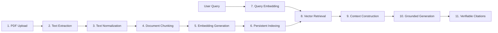

# DocuMind 1.0 — Baseline RAG Pipeline & Architecture Specification

**Repository:** `X:\Projects\Documind`  
**Phase:** Phase 1 — Literature Review and Baseline  
**Document Status:** Conceptual Pipeline Specification (WP-01 Deliverable 5)  
**Governance Standard:** Conceptual architecture only; **no premature technology selection** (e.g. Chroma vs. FAISS or specific embedding model). Selection follows controlled Phase 2–5 experiments.  
**Hardware & Budget Context:** Intel Core i5-1135G7 (4C/8T, 2.4–4.2 GHz), 24 GB RAM, No discrete GPU; ₹0 financial budget; strictly offline / local CPU execution.

---

## 1. Architectural Overview & Design Principles

The DocuMind 1.0 Baseline RAG Pipeline defines the conceptual dataflow and processing stages required to ingest raw PDF documents, extract and chunk text, generate dense embeddings, persist vector indices, retrieve relevant evidence, and produce grounded, cited answers using local open-source language models.

### Core Architectural Principles
1. **Modularity & Loose Coupling:** Every stage is encapsulated behind abstract Python interfaces (`DocParser`, `Chunker`, `Embedder`, `VectorStore`, `Retriever`, `Generator`). Swapping implementations (e.g., FAISS for ChromaDB) requires zero changes to upstream or downstream stages.
2. **Strict Provenance & Metadata Invariance:** Every chunk carries immutable metadata (`doc_id`, `source_filename`, `page_number`, `chunk_id`, `char_start`, `char_end`) from ingestion through generation to ensure verifiable page-level citation.
3. **Hardware-Conscious CPU Execution:** Designed to operate efficiently within an 8-thread CPU envelope and 24 GB RAM without memory exhaustion or thermal throttling.
4. **Defensive Grounding:** Enforces strict context-bounded generation with explicit abstention mechanisms for unanswerable queries.



---

## 2. Stage-by-Stage Conceptual Pipeline Specification

### Stage 1: PDF Upload & Validation
- **Input:** Raw binary PDF byte stream or local filesystem path (`pathlib.Path`).
- **Output:** Validated `DocumentPayload` object containing raw byte buffer, verified MIME type (`application/pdf`), and cryptographic SHA-256 `doc_id`.
- **Primary Responsibility:** Accept uploaded file, verify integrity, enforce maximum file size limits (e.g. 50 MB), generate a deterministic `doc_id`, and ensure sensitive files (e.g. candidate resumes) are kept strictly local.
- **Metadata Requirements:**
  - `doc_id`: Hexadecimal SHA-256 hash of file content.
  - `source_filename`: Original filename sanitized against directory traversal.
  - `file_size_bytes`: Integer size.
  - `upload_timestamp`: ISO 8601 UTC timestamp.
- **Failure Modes & Edge Cases:** Corrupt PDF headers; password-protected/encrypted PDFs; zero-byte files; path traversal attempts in filenames.
- **Testing Requirements:** Unit tests validating file signature sniffing, hash determinism, and rejection of non-PDF or encrypted payloads.
- **Relevant Research Questions:** Phase 0 data isolation audits; storage footprint of multi-document uploads.

---

### Stage 2: Document Text Extraction
- **Input:** Validated `DocumentPayload`.
- **Output:** List of `PageDocument` objects, each containing extracted plain text, 1-indexed `page_number`, and page layout dimensions.
- **Primary Responsibility:** Parse PDF page streams into readable plain text while maintaining accurate page boundaries and preserving whitespace structures.
- **Metadata Requirements:**
  - `doc_id`: Inherited SHA-256 hash.
  - `page_number`: 1-indexed integer.
  - `total_pages`: Total document page count.
  - `page_char_count`: Length of extracted text.
- **Failure Modes & Edge Cases:** Scanned image-only PDFs (zero extractable text streams); complex multi-column reading orders where paragraphs interleave; embedded tables flattening into unreadable token soups; font encoding errors producing replacement glyphs (`\ufffd`).
- **Testing Requirements:** Comparative benchmarking between extraction engines (`pypdf`, `PyMuPDF`, `pdfplumber`) evaluating extraction speed (ms/page) and structural fidelity on sample technical PDFs.
- **Relevant Research Questions:** Phase 2 PDF parsing spike (RQ-01).

---

### Stage 3: Text Normalization & Cleaning
- **Input:** List of `PageDocument` objects.
- **Output:** List of `NormalizedPageDocument` objects containing cleaned text and character coordinate mappings.
- **Primary Responsibility:** Strip non-printable control characters, normalize Unicode representations (NFC normalization), repair hyphenated line-breaks (e.g. `"inter-\nchange"` $\rightarrow$ `"interchange"`), and consolidate excessive whitespace without destroying intentional paragraph breaks.
- **Metadata Requirements:**
  - Preserves all upstream page metadata.
  - `cleaning_flags`: Bitmask recording modifications (e.g. `hyphen_repaired`, `control_chars_stripped`).
- **Failure Modes & Edge Cases:** Erroneous de-hyphenation of compound words (e.g. `"cost-effective"` $\rightarrow$ `"costeffective"`); aggressive whitespace stripping destroying ASCII tables or code blocks.
- **Testing Requirements:** Regex regression suite testing hyphenation repair, Unicode normalization, and preservation of intentional formatting.
- **Relevant Research Questions:** Impact of text cleaning on downstream tokenization and embedding fidelity.

---

### Stage 4: Document Chunking
- **Input:** Cleaned `NormalizedPageDocument` stream.
- **Output:** List of `TextChunk` objects, each containing chunk text ($T$), token count, and strict span metadata.
- **Primary Responsibility:** Segment text into semantically cohesive units within targeted token bounds (e.g. 256 to 512 tokens) with controlled overlap (e.g. 10%), ensuring chunk boundaries align with paragraphs and sentences rather than arbitrary token cuts.
- **Metadata Requirements:**
  - `chunk_id`: Deterministic UUID or format `{doc_id}_p{page}_c{chunk_index}`.
  - `doc_id`: Source document hash.
  - `source_filename`: Human-readable filename.
  - `page_number`: Exact 1-indexed page where chunk originated.
  - `chunk_index`: Monotonically increasing integer per document.
  - `char_start`: Character offset in page text.
  - `char_end`: Character offset in page text.
  - `token_count`: Integer count based on candidate tokenizer.
- **Failure Modes & Edge Cases:** Chunks exceeding maximum sequence length of candidate embedding model; split sentences that obscure the subject or predicate; zero-length chunks generated from trailing page whitespace.
- **Testing Requirements:** Grid-search evaluation across chunk sizes (256, 512, 1024) and overlap ratios (0%, 10%, 20%); unit tests confirming invariant metadata preservation.
- **Relevant Research Questions:** RQ-01 (Recursive vs. Fixed chunking) and RQ-06 (Chunk size/overlap grid search).

---

### Stage 5: Dense Embedding Generation
- **Input:** List of `TextChunk` objects.
- **Output:** List of `EmbeddedChunk` objects containing 384-dimensional dense float32 vectors paired with their corresponding `chunk_id` and metadata.
- **Primary Responsibility:** Pass chunk text through local sentence-transformer candidate model on CPU; apply candidate-specific prefix formatting (e.g. `passage: ` for E5); apply L2 unit normalization ($\|v\|_2 = 1.0$) to enable cosine equivalence via inner product.
- **Metadata Requirements:**
  - Preserves all chunk metadata.
  - `embedding_model_id`: String identifying model and revision (e.g. `"all-MiniLM-L6-v2"`).
  - `embedding_dimension`: 384.
  - `is_normalized`: Boolean `True`.
- **Failure Modes & Edge Cases:** Text exceeding the model's maximum sequence length (causing silent truncation at 256 or 512 tokens); memory spikes during large batch encoding; unnormalized embeddings causing invalid similarity rankings.
- **Testing Requirements:** Unit tests validating vector dimensionality (exactly 384 floats), unit norm ($\sum v_i^2 \approx 1.0 \pm 10^{-5}$), batch latency profiling, and truncation logging.
- **Relevant Research Questions:** RQ-02 (Candidate embedding shootout on CPU).

---

### Stage 6: Persistent Vector Indexing
- **Input:** Batch of `EmbeddedChunk` objects.
- **Output:** Persisted local vector index and metadata catalog written to disk.
- **Primary Responsibility:** Store vectors and metadata in a durable, local filesystem store; support idempotent additions (upsert by `chunk_id`); support querying by vector and filtering by document/page metadata.
- **Metadata Requirements:**
  - Full chunk metadata stored in SQLite/parquet catalog.
  - Index configuration records (distance metric: Inner Product / Cosine).
  - Persistence path inside project workspace (`data/processed/vector_index/`).
- **Failure Modes & Edge Cases:** Index corruption on sudden process termination; duplicate chunk insertions causing skewed top-$K$ results; filesystem permission errors; memory leaks during incremental index updates.
- **Testing Requirements:** Concurrency and durability tests; idempotency verification (re-inserting identical documents results in zero duplicate chunks); index save/load roundtrip verification.
- **Relevant Research Questions:** RQ-03 (FAISS vs. Chroma persistence and update ergonomics).

---

### Stage 7: Query Embedding & Preprocessing
- **Input:** Raw user question string ($Q$).
- **Output:** Normalized query string, 384-dimensional query vector ($v_q$), and query metadata.
- **Primary Responsibility:** Sanitize query text; apply model-specific query instruction prefixes (e.g. `"query: "` for E5 or instruction string for BGE); generate normalized dense vector on CPU using the identical embedding model employed for chunk indexing.
- **Metadata Requirements:**
  - `raw_query`: Original input.
  - `formatted_query`: Text actually passed to embedding model.
  - `embedding_latency_ms`: Time taken for query forward pass.
- **Failure Modes & Edge Cases:** Mismatched prefix formatting between query and passage models; empty or whitespace-only queries; queries containing adversarial prompt injection payloads.
- **Testing Requirements:** Verification that identical queries produce deterministic vectors; validation that query prefix formatting matches model card requirements.
- **Relevant Research Questions:** Impact of query prefix formatting on MRR@10.

---

### Stage 8: Top-K Vector Retrieval
- **Input:** Query vector ($v_q$), candidate parameter $K$ (e.g. $K=5$), optional metadata filter (`doc_id`).
- **Output:** Ordered list of `RetrievedChunk` objects, sorted descending by similarity score ($S_i \in [-1, 1]$).
- **Primary Responsibility:** Perform exact or approximate nearest neighbor search across persisted index; return top-$K$ most similar chunks with complete provenance metadata and similarity scores.
- **Metadata Requirements:**
  - Preserves all chunk metadata.
  - `similarity_score`: Inner product / cosine similarity float.
  - `retrieval_rank`: 1-indexed integer rank.
- **Failure Modes & Edge Cases:** Returning irrelevant chunks when no relevant content exists (failure to apply distance threshold cutoffs); returning duplicate chunks from redundant index entries; index search timeouts.
- **Testing Requirements:** Precision@K, Recall@K, and MRR@K evaluation against ground-truth QA benchmark; search latency measurement under varying chunk counts (1k to 10k).
- **Relevant Research Questions:** RQ-04 (Hybrid vs. Dense retrieval) and RQ-05 (Reranking).

---

### Stage 9: Context Construction & Budget Optimization
- **Input:** List of top-$K$ `RetrievedChunk` objects, maximum context token budget (e.g. 1500 tokens).
- **Output:** Formatted `ContextBlock` string and list of included `RetrievedChunk` references.
- **Primary Responsibility:** Deduplicate overlapping passages; assemble chunks into structured markdown context with explicit document and page tags; enforce hard token budget limits; order passages strategically to mitigate "lost in the middle" attention degradation (placing highest-ranked evidence at the boundary positions).
- **Metadata Requirements:**
  - `total_context_tokens`: Count of tokens consumed by context.
  - `retained_chunk_ids`: List of chunk IDs fitting within budget.
  - `dropped_chunk_ids`: List of chunks omitted due to budget truncation.
- **Failure Modes & Edge Cases:** Overfilling prompt context causing LLM context window truncation; burying the most critical chunk in the center of a long context block (Liu et al. 2023); malformed delimiter tags confusing the LLM.
- **Testing Requirements:** Context boundary packing tests; verification that context ordering places top-1 chunks at strategic prompt edges; budget overflow assertion tests.
- **Relevant Research Questions:** Informs Phase 5 prompt engineering and context packing algorithms.

---

### Stage 10: Grounded Generation with Local LLM
- **Input:** Formatted `ContextBlock`, user query, system prompt enforcing strict grounding and abstention.
- **Output:** Raw response string containing answer text and inline citation markers.
- **Primary Responsibility:** Execute local quantized language model (3B to 7B parameters) on CPU (via Ollama or llama.cpp); enforce zero-temperature deterministic decoding ($T=0.0$); constrain model to synthesize answers solely from provided context and state explicit refusal if context is insufficient.
- **Metadata Requirements:**
  - `llm_model_id`: Quantized model identifier (e.g. `"llama3.2:3b-instruct-q4_K_M"`).
  - `inference_latency_ms`: Generation duration.
  - `tokens_generated`: Integer token count.
  - `tokens_per_second`: CPU throughput metric.
- **Failure Modes & Edge Cases:** Hallucination of external knowledge when retrieved context is thin; model ignoring negative constraints and fabricating plausibly sounding answers; generation timeouts on resource-constrained CPU; infinite repetitive generation loops.
- **Testing Requirements:** Faithfulness and refusal benchmarks on answerable vs. unanswerable test suites; latency and throughput profiling on Intel i5-1135G7 CPU.
- **Relevant Research Questions:** RQ-07 (Local model refusal accuracy and grounding fidelity).

---

### Stage 11: Structured Citation Extraction & Verification
- **Input:** Generated response text, list of retained `RetrievedChunk` objects.
- **Output:** Final `GroundedAnswer` object containing cleaned answer prose and structured list of `Citation` objects:
  ```json
  {
    "answer": "...",
    "has_sufficient_context": true,
    "citations": [
      {
        "citation_id": 1,
        "source_filename": "annual_report.pdf",
        "doc_id": "a1b2c3...",
        "page_number": 4,
        "supporting_quote": "Revenue increased by 14% year-over-year..."
      }
    ]
  }
  ```
- **Primary Responsibility:** Parse inline citation brackets (e.g. `[Doc 1, p. 4]`); match cited document and page against the actual metadata of chunks provided in the prompt; verify that cited passages actually contain the asserted facts; strip unverified citations.
- **Metadata Requirements:**
  - `citation_count`: Total valid citations.
  - `unmatched_citations`: Citations generated by LLM that do not map to provided chunks.
  - `citation_precision`: Ratio of valid citations to total generated citations.
- **Failure Modes & Edge Cases:** Hallucinated page numbers; citations pointing to documents not present in prompt; malformed citation brackets that fail regex parsing.
- **Testing Requirements:** Citation precision and coverage unit tests; schema validation tests confirming Pydantic JSON parsing.
- **Relevant Research Questions:** Evaluation of citation fidelity without external API dependencies.

---

## 3. Concrete Data Contracts & Schemas

To ensure strict modularity and decoupling between components, all pipeline stages exchange typed Pydantic data models:

```python
from pydantic import BaseModel, Field
from typing import List, Dict, Any, Optional

class ChunkMetadata(BaseModel):
    chunk_id: str
    doc_id: str
    source_filename: str
    page_number: int
    chunk_index: int
    char_start: int
    char_end: int
    token_count: int

class TextChunk(BaseModel):
    text: str
    metadata: ChunkMetadata

class RetrievedChunk(BaseModel):
    chunk: TextChunk
    similarity_score: float
    retrieval_rank: int

class Citation(BaseModel):
    citation_id: int
    doc_id: str
    source_filename: str
    page_number: int
    supporting_quote: Optional[str] = None

class GroundedAnswer(BaseModel):
    query: str
    answer: str
    has_sufficient_context: bool
    citations: List[Citation] = Field(default_factory=list)
    retrieved_context: List[RetrievedChunk] = Field(default_factory=list)
    generation_metadata: Dict[str, Any] = Field(default_factory=dict)
```

---

## 4. Pipeline Testing & Verification Matrix

| Pipeline Stage | Verification Method | Pass Criteria | Responsible Test Module |
| :--- | :--- | :--- | :--- |
| **Ingestion & Extraction** | Golden PDF text comparison against manual text dumps. | 100% character recovery of non-scanned text; exact page numbering. | `tests/unit/test_ingestion.py` |
| **Chunking** | Boundary preservation and token budget assertions. | Zero chunks exceeding token budget; zero empty chunks; valid offsets. | `tests/unit/test_chunking.py` |
| **Embedding Generation** | Shape and normalization checks. | Output shape `(N, 384)`; $\|v\|_2 = 1.0 \pm 10^{-5}$; CPU time $< 50$ ms/chunk. | `tests/unit/test_embedding.py` |
| **Vector Indexing** | In-memory vs. on-disk load assertions; idempotency test. | Re-inserting identical payload produces identical chunk count. | `tests/unit/test_vector_store.py` |
| **Vector Retrieval** | Retrieval over synthetic anchor chunks. | Top-1 chunk matches ground-truth target with similarity $> 0.85$. | `tests/unit/test_retrieval.py` |
| **Grounded Generation** | Refusal tests on 10 out-of-domain questions. | $\ge 90\%$ refusal rate on unanswerable queries; 0 external hallucinations. | `tests/integration/test_grounding.py` |
| **Citation Verification** | Parsing generated citations against prompt chunks. | 100% of generated citations map to genuine source chunks and pages. | `tests/integration/test_citations.py` |
