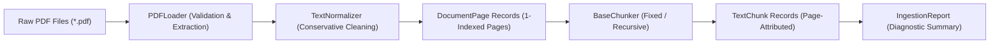

# DocuMind — Document Ingestion and Chunking Pipeline Architecture

**Work Package:** WP-02  
**Roadmap Phase:** Phase 2 — Document Ingestion and Chunking  
**Status:** Implemented & Verified  
**Runtime Environment:** Local-First (Windows x86_64, Intel i5-1135G7, 24 GB RAM)  
**Cost / External Dependency:** ₹0 paid APIs, zero cloud infrastructure, zero network transmission  

---

## 1. Overview and Design Principles

The DocuMind Ingestion Pipeline serves as the foundational data ingestion layer for the modular DocuMind Retrieval-Augmented Generation (RAG) system. It transforms raw, heterogeneous PDF documents into structured, normalized, and page-attributed text chunks ready for vector embedding and retrieval indexing.



### Core Architectural Principles
1. **Local-First & Complete Privacy:** All extraction, normalization, and chunking run 100% locally on the host machine. Private documents and resumes are never transmitted over network sockets or sent to external APIs.
2. **Deterministic Identifiers:** Document IDs are cryptographic SHA-256 hashes of file contents; chunk IDs deterministically combine document hashes, ordinal sequence indices, and strategy identifiers.
3. **Strict Page Attribution:** Text spans that cross physical PDF page boundaries retain all contributing page numbers (`page_numbers: List[int]`) alongside primary references (`start_page`, `end_page`).
4. **Lightweight Python Dataclasses:** Zero heavy ORM or Pydantic runtime overhead for raw document data structures.
5. **Fail-Safe Processing:** Processing errors on individual malformed, encrypted, or corrupted files fail gracefully with explicit diagnostic reports without crashing batch operations.

---

## 2. Module Responsibilities and Package Structure

The package is organized under `src/documind/ingestion/`:

```text
src/documind/
├── __init__.py                  # Top-level DocuMind package
├── config.py                    # IngestionConfig dataclass
└── ingestion/
    ├── __init__.py              # Public exports (IngestionPipeline, PDFLoader, etc.)
    ├── schemas.py               # DocumentPage, TextChunk, DocumentReport, IngestionReport
    ├── text_normalizer.py       # Conservative text normalization
    ├── pdf_loader.py            # PDF validation and PyMuPDF text extractor
    ├── chunker.py               # FixedSizeChunker, RecursiveCharacterChunker, create_chunker
    └── pipeline.py              # IngestionPipeline orchestrator
```

### Module Responsibilities

| Module | Core Responsibility |
| :--- | :--- |
| `schemas.py` | Defines standardized Python dataclasses (`DocumentPage`, `TextChunk`, `DocumentReport`, `IngestionReport`) with `.to_dict()` serialization. |
| `text_normalizer.py` | Conservatively normalizes whitespace, line wraps, and control characters while strictly preserving technical identifiers, decimals, and paragraph breaks. |
| `pdf_loader.py` | Validates file signatures (`%PDF-`), reads PDF byte streams, detects encryption and malformed headers, detects image-only/scanned PDFs, and extracts page-by-page text. |
| `chunker.py` | Implements sliding-window (`FixedSizeChunker`) and hierarchical delimiter (`RecursiveCharacterChunker`) splitting with mathematical interval page-overlap tracking. |
| `pipeline.py` | Orchestrates the end-to-end ingestion lifecycle for single files or batches, measuring wall-clock latency and producing diagnostic reports. |
| `config.py` | Centralizes default parameters (`chunk_size=1000`, `chunk_overlap=150`, `chunking_strategy="recursive"`, `max_file_size_bytes=52428800`). |

---

## 3. Extraction Engine Selection: PyMuPDF vs. pypdf

A technical comparison was conducted on the target Windows environment (Intel i5-1135G7 @ 2.40 GHz, Python 3.13.1) using the project's public research PDF archive:

### Empirical Benchmark Results

| Test Document | Page Count | Metric | `PyMuPDF` (v2.1.0) | `pypdf` (v6.9.2) | PyMuPDF Advantage |
| :--- | :---: | :--- | :---: | :---: | :---: |
| `BASWE-15-RAG-Concepts-Guide.pdf` | 14 | Total Latency | **102.6 ms** | 1,495.1 ms | **14.58x faster** |
| | | Per-Page Latency | **7.33 ms/page** | 106.79 ms/page | |
| `Everything-to-know-about-RAG.pdf` | 92 | Total Latency | **840.6 ms** | 16,418.5 ms | **19.53x faster** |
| | | Per-Page Latency | **9.14 ms/page** | 178.46 ms/page | |

### Qualitative Evaluation

1. **Reading-Order & Layout Preservation:** PyMuPDF's C-level layout engine (`fitz`/MuPDF) reconstructs text flow and block structure with superior fidelity compared to `pypdf`'s pure-Python stream decoder.
2. **Empty Page & Encryption Handling:** PyMuPDF provides instant inspection of `page.rect`, `doc.is_encrypted`, and `doc.needs_pass` without throwing unhandled exceptions.
3. **Scanned PDF Detection:** Both libraries report 0 text characters for image-only scans. PyMuPDF extracts this in sub-millisecond time, allowing the loader to immediately emit actionable diagnostic warnings:
   > *"Document contains no extractable text across all pages. Scanned image pages require Optical Character Recognition (OCR), which is outside the scope of this ingestion pipeline."*
4. **Integration on Windows:** PyMuPDF distributes pre-compiled binary wheels for Windows x86_64 across Python 3.9 through 3.13, requiring zero local compilation or external runtime DLLs.

**Conclusion:** `PyMuPDF` was selected as the primary extraction engine for DocuMind.

---

## 4. Data Models and Schemas

### `DocumentPage`
Represents an individual physical page extracted from a source document:
```python
@dataclass
class DocumentPage:
    document_id: str          # SHA-256 hash of the entire source PDF
    document_name: str        # Base filename (e.g. "report.pdf")
    source_path: str          # Absolute or canonical filesystem path
    page_number: int          # 1-indexed physical page number
    text: str                 # Normalized plain text
    metadata: Dict[str, Any]  # Page dimensions, raw char count, empty status
```

### `TextChunk`
Represents a discrete text unit prepared for embedding and retrieval:
```python
@dataclass
class TextChunk:
    chunk_id: str             # Deterministic hash ID: "{doc_id[:12]}_c{index:04d}_{strat}"
    document_id: str          # Source document SHA-256
    document_name: str        # Source document filename
    source_path: str          # Source file path
    chunk_index: int          # 0-indexed position within document sequence
    text: str                 # Exact chunk text content
    page_numbers: List[int]   # All contributing 1-indexed page numbers
    start_page: int           # Earliest contributing page number
    end_page: int             # Latest contributing page number
    chunking_strategy: str    # "recursive" or "fixed"
    chunk_size: int           # Target size in characters
    chunk_overlap: int        # Overlap size in characters
    char_start: int           # Start character offset in unified document text
    char_end: int             # End character offset in unified document text
    metadata: Dict[str, Any]  # Additional context (char_count, is_multipage, etc.)
```

### `IngestionReport`
Diagnostic summary returned by the orchestrator:
```python
@dataclass
class IngestionReport:
    documents_submitted: int
    documents_processed: int
    documents_failed: int
    pages_extracted: int
    empty_pages: int
    chunks_generated: int
    errors: List[Dict[str, Any]]
    processing_time_sec: float
    document_reports: List[DocumentReport]
```

---

## 5. Text Normalization Behavior

The `TextNormalizer` applies conservative transformations designed to eliminate extraction noise without modifying domain-specific technical terminology:

1. **Unicode NFC Normalization:** Unifies composed vs. decomposed glyph representations (e.g., `resumé`).
2. **Control Character Elimination:** Strips ASCII non-printable control characters (`\x00`–`\x1F`, `\x7F`) while strictly retaining horizontal tabs (`\t`) and line feeds (`\n`).
3. **Newline Standardization:** Standardizes `\r\n` (Windows) and `\r` (legacy Mac) to `\n` (POSIX standard).
4. **Excessive Vertical Space Consolidation:** Replaces 3 or more consecutive newlines with `\n\n` to preserve semantic paragraph boundaries without artificial inflation.
5. **Safe Linebreak De-hyphenation:** Merges words split across linebreaks matching `([a-z])-\n([a-z])` (e.g. `imple-\nmentation` $\rightarrow$ `implementation`) while strictly preserving technical identifiers, version tags, and numbers (e.g. `i5-1135G7`, `v2.1.0-alpha`, `10-20`).

---

## 6. Chunking Strategies and Multi-Page Attribution

### Measurement Unit
All sizes and overlaps are measured in **characters** (`chunk_size`, `chunk_overlap`). Characters provide an exact, dependency-free local measurement. Future work packages introducing local tokenizers (e.g. HuggingFace `tokenizers` or `tiktoken`) can map tokens to character approximations without altering the ingestion interfaces.

### Strategies Supported
1. **`FixedSizeChunker`:**
   - Strict character-window sliding approach with step size $S = \text{chunk\_size} - \text{chunk\_overlap}$.
   - Ideal for benchmark baselines and uniform length enforcement.
2. **`RecursiveCharacterChunker`:**
   - Hierarchical splitting utilizing progressive delimiters: `["\n\n", "\n", ". ", " ", ""]`.
   - Prioritizes paragraph preservation, then line breaks, then sentence boundaries, before falling back to word and character splits.
   - Slices directly from original text offsets to prevent delimiter stripping artifacts.

### Multi-Page Attribution Algorithm
When a document's extracted pages are aggregated into a continuous stream, the chunker maintains a page span map:
$$\text{PageSpan}_i = (\text{page\_number}, \text{start\_offset}_i, \text{end\_offset}_i)$$

For each generated text chunk with character bounds $[C_{\text{start}}, C_{\text{end}})$, a page $i$ is attributed if and only if the intervals overlap:
$$\max(C_{\text{start}}, \text{start\_offset}_i) < \min(C_{\text{end}}, \text{end\_offset}_i)$$

- If a chunk spans pages 3 and 4, `page_numbers = [3, 4]`, `start_page = 3`, `end_page = 4`, and `metadata["is_multipage"] = True`.
- Page citations can thus be traced back to the exact source page in retrieval and generation phases.

---

## 7. Configuration

Pipeline settings are managed via `documind.config.IngestionConfig`:

```python
from documind.config import IngestionConfig

config = IngestionConfig(
    chunk_size=1000,              # Target size in characters (default: 1000)
    chunk_overlap=150,            # Overlap in characters (default: 150)
    chunking_strategy="recursive",# "recursive" or "fixed"
    max_file_size_bytes=52428800, # 50 MB safety cap
    extract_empty_pages=False,    # Skip blank pages while preserving page indices
)
```

---

## 8. Execution and Usage

### Programmatic Python Usage

```python
from pathlib import Path
from documind.ingestion.pipeline import IngestionPipeline

# Initialize pipeline
pipeline = IngestionPipeline(
    chunk_size=1000,
    chunk_overlap=150,
    chunking_strategy="recursive",
)

# Ingest multiple PDF documents
pdf_paths = [
    Path("research/technical_references/BASWE-15-RAG-Concepts-Guide.pdf"),
    Path("research/technical_references/Everything-to-know-about-RAG.pdf"),
]
chunks, report = pipeline.ingest_files(pdf_paths)

print(f"Processed {report.documents_processed} files in {report.processing_time_sec:.3f}s")
print(f"Extracted {report.pages_extracted} pages into {report.chunks_generated} chunks.")

for chunk in chunks[:3]:
    print(f"[{chunk.chunk_id}] Pages: {chunk.page_numbers} | Chars: {len(chunk.text)}")
    print(f"Text preview: {chunk.text[:120]}...\n")
```

### CLI Smoke Test Script

To verify pipeline health from PowerShell or Command Prompt:

```powershell
# Set PYTHONPATH and execute smoke test
$env:PYTHONPATH="src"
python scripts/test_ingestion.py
```

### Running Automated Test Suite

```powershell
$env:PYTHONPATH="src"
pytest -v tests
```

---

## 9. Known Limitations

1. **Character vs. Token Units:** Chunk boundaries are calculated in characters. Because token lengths vary by language and tokenization scheme (e.g., ~4 characters per token in English), token counts may fluctuate around $\pm 15\%$ when mapped to downstream embedding models.
2. **Scanned Documents (OCR):** Scanned, image-only PDFs contain 0 digital text streams. The pipeline detects this condition and raises an informative diagnostic warning; OCR (e.g. Tesseract or PaddleOCR) is deferred to future specialized extensions.
3. **Complex Tables:** Multi-column tables and complex financial grids are extracted in linear text flow. Table structure preservation requires specialized layout parsers (e.g., pdfplumber or vision models) which will be evaluated in subsequent releases.
