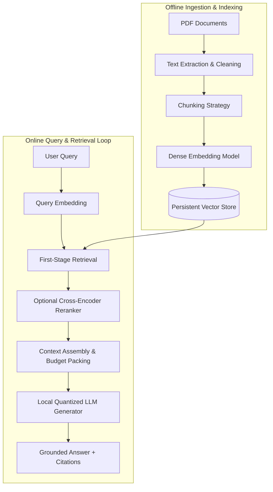

# DocuMind 1.0 — Comprehensive Literature Review & Technical Foundation

**Repository:** `X:\Projects\Documind`  
**Phase:** Phase 1 — Literature Review and Baseline  
**Document Status:** Comprehensive Literature Review (WP-01 Deliverable 1)  
**Hardware & Budget Context:** Intel Core i5-1135G7 (4C/8T, 2.4–4.2 GHz), 24 GB RAM, No discrete GPU; ₹0 financial budget; strictly offline / local CPU execution.  
**Methodological Standard:** *Understand → Hypothesize → Experiment → Measure → Decide → Implement → Document*

---

## 1. Introduction to Retrieval-Augmented Generation (RAG)

Large Language Models (LLMs) trained on massive text corpora exhibit remarkable linguistic fluency and broad general reasoning capabilities. However, when deployed in real-world knowledge-intensive tasks, purely parametric models suffer from three fundamental architectural limitations:
1. **Factual Hallucination:** Generative models optimize for plausible next-token probability rather than factual truth. When queried on domain-specific, proprietary, or recent information absent from their pre-training data, they frequently fabricate convincing but false statements.
2. **Temporal Staleness:** Parametric memory is static, frozen at the completion of the training cutoff date. Updating a model's factual knowledge base typically requires full fine-tuning or continuous pre-training, which is computationally prohibitive and prone to catastrophic forgetting.
3. **Lack of Provenance & Verifiability:** Purely parametric generations cannot natively provide direct source attribution or verifiable page-level references. In mission-critical applications (such as legal, technical, medical, and institutional analysis), an answer without verifiable evidence is unacceptable.

**Retrieval-Augmented Generation (RAG)** overcomes these limitations by decoupling knowledge storage from linguistic reasoning. In a RAG architecture, an external non-parametric knowledge store (such as a vector database or inverted index) acts as the dynamic, updatable repository of truth, while the language model serves as an in-context synthesis engine. When a user submits a query, the system dynamically retrieves relevant evidence passages from the non-parametric index and injects them into the language model's prompt context, constraining the model to generate factual, grounded answers supported by verifiable citations.

---

## 2. Foundational Architecture of RAG

### 2.1 The Parametric vs. Non-Parametric Duality
The theoretical formulation of modern RAG originates with **Lewis et al. (2020)** in *Retrieval-Augmented Generation for Knowledge-Intensive NLP Tasks*. Lewis et al. formalized the RAG architecture as a hybrid probabilistic model combining:
- **Parametric Memory:** A pre-trained sequence-to-sequence language model (originally BART) with parameters $\theta$, capable of complex linguistic generation, syntactic transformation, and contextual reasoning.
- **Non-Parametric Memory:** A dense vector index of text passages accessed via a neural dual-encoder retriever (Dense Passage Retrieval, DPR; Karpukhin et al. 2020) with parameters $\eta$.

Lewis et al. formulated two complementary probabilistic frameworks for conditioning generation on retrieved evidence:
1. **RAG-Sequence Model:** The model uses the *same* retrieved passage $z$ to condition the entire generated sequence $y$:
   $$P_{\text{RAG-Sequence}}(y|x) \approx \sum_{z \in \text{top-}K(P(\cdot|x))} P_\eta(z|x) \prod_{i=1}^N P_\theta(y_i|x, z, y_{1:i-1})$$
   *Operational Meaning:* This formulation assumes that a single cohesive passage contains the necessary context to generate the complete answer. It is well-suited for single-fact lookups and concise factual answers.
2. **RAG-Token Model:** The model can marginally condition on *different* passages $z$ at each individual token generation step $i$:
   $$P_{\text{RAG-Token}}(y|x) = \prod_{i=1}^N \sum_{z \in \text{top-}K(P(\cdot|x))} P_\eta(z|x) P_\theta(y_i|x, z, y_{1:i-1})$$
   *Operational Meaning:* This formulation allows the generator to synthesize evidence dynamically across multiple disparate passages within a single response, switching attention mid-sentence.

### 2.2 The Modern Decoupled RAG Pipeline
While Lewis et al. trained the retriever and generator end-to-end via backpropagation through the top-$K$ marginalization, modern production systems adopt a **decoupled, modular architecture**. A modern RAG pipeline consists of two distinct asynchronous phases:

---

## 3. Document Ingestion and Chunking Strategies

A RAG system's retrieval quality is fundamentally bounded by the quality of its document ingestion and chunking. If a chunking algorithm truncates a critical sentence or intermingles two disparate topics, the downstream retriever cannot recover the lost coherence.

### 3.1 PDF Text Extraction Challenges
Extracting clean text from Portable Document Format (PDF) files is notoriously non-trivial because the PDF specification is designed for visual rendering, not textual semantic parsing. A PDF represents content as visual instructions (`draw glyph at coordinate (x, y)`), lacking inherent awareness of words, paragraphs, reading orders, or tables.
- **Multi-Column Layouts:** Naive parsers extract text in stream order, which often reads horizontally across two columns, interleaving sentences from disparate articles into an unreadable token soup.
- **Hyphenation & Line-Wrapping:** Words broken across lines (e.g., `"con- \nfiguration"`) corrupt tokenization unless programmatically normalized back to their root word.
- **Table Extraction:** Grid structures frequently flatten into disjointed numbers and labels, destroying column-to-row relationships.
- **Engine Comparison:**
  - `pypdf`: Pure Python, minimal dependencies, fast, but exhibits poor handling of complex multi-column layouts and tables.
  - `PyMuPDF` (MuPDF C-library bindings): Extremely fast, layout-aware, robust font handling, excellent page geometry extraction.
  - `pdfplumber`: Excellent visual table extraction, but significantly slower CPU execution per page.

### 3.2 Chunking Paradigms & Trade-offs
No single chunking strategy is universally superior across all document corpora. Engineering chunking requires navigating explicit trade-offs:

1. **Fixed-Size Chunking (Character or Token Sliding Window):**
   - *Mechanism:* Segments text at arbitrary fixed intervals (e.g. 500 characters) with a fixed overlap (e.g. 50 characters).
   - *Trade-off:* Trivial to implement and computationally negligible, but completely agnostic to grammatical boundaries. Frequently truncates words, equations, and sentences mid-thought, creating high boundary-cutoff errors.
2. **Recursive Character Chunking:**
   - *Mechanism:* Hierarchically attempts to split text using a prioritized list of structural delimiters (`\n\n` for paragraphs, `\n` for lines, ` ` for words, `""` for characters) until the chunk size falls within the target token window.
   - *Trade-off:* Preserves natural paragraph and sentence boundaries, maintaining topical coherence. Serves as the robust default baseline for technical documentation and resumes.
3. **Sentence-Based Chunking:**
   - *Mechanism:* Uses natural language processing boundary detection (e.g. spaCy or NLTK) to assemble chunks composed of full, unbroken sentences.
   - *Trade-off:* Guarantees complete thoughts, but produces variable chunk lengths that can oscillate widely between short bullet points and long complex compound sentences.
4. **Semantic Chunking:**
   - *Mechanism:* Calculates the cosine distance between embedding vectors of consecutive sentences. When the semantic distance exceeds a predefined threshold (indicating a topical transition), a chunk boundary is placed.
   - *Trade-off:* Produces semantically pure passages, but imposes heavy CPU computational penalties (requiring dozens of embedding forward passes per page) and is fragile to threshold hyperparameter tuning.
5. **Hierarchical / Parent-Child Chunking:**
   - *Mechanism:* Splits documents into small "child" chunks (e.g. 128 tokens) for fine-grained semantic embedding, and maps each child to a larger "parent" section (e.g. 512–1024 tokens) or complete document (Sarthi et al. 2024).
   - *Trade-off:* Solves the fundamental tension between retrieval precision (small chunks avoid semantic dilution) and generation context (large chunks provide necessary context for synthesis). Imposes higher indexing complexity and requires dual-layer storage.

---

## 4. Embedding Models and Vector Indexing

### 4.1 Dense Embedding Spaces & Similarity Metrics
Dense embedding models map variable-length text strings into continuous $d$-dimensional vector spaces ($\mathbb{R}^d$), where geometric proximity corresponds to semantic similarity.
- **Bi-Encoder Architecture:** As established by **Reimers & Gurevych (2019)** in Sentence-BERT, a dual-encoder maps a query $q$ and a document chunk $d$ independently:
  $$u = \text{Embed}(q), \quad v = \text{Embed}(d)$$
  Because chunk vectors are pre-computed offline, searching an index of millions of passages requires only computing $u$ at query time and performing geometric nearest-neighbor search.
- **Vector Normalization (L2 Norm):**
  When vectors are normalized to unit length ($\|u\|_2 = 1.0$), the cosine similarity simplifies directly to the inner product (dot product):
  $$\text{CosineSimilarity}(u, v) = \frac{u \cdot v}{\|u\|_2 \|v\|_2} = u \cdot v$$
  Operating over unit-normalized vectors allows vector search engines to use inner product matrix multiplication (`IndexFlatIP`), which is significantly faster to compute on modern CPU SIMD instruction sets (AVX-512 / AVX2) than full Euclidean distance or unnormalized cosine calculations.

### 4.2 Candidate Embedding Models Analysis
DocuMind maintains three primary candidate embedding families, all operating within the efficient **384-dimensional** embedding regime on local CPU hardware:

1. **`all-MiniLM-L6-v2` (Sentence-Transformers):**
   - *Architecture:* 6-layer MiniLM distilled from BERT (22.7 million parameters).
   - *Provisional Max Context:* **256 tokens** (strictly verified against model card).
   - *Prefix Requirements:* None (symmetric encoding).
   - *CPU Profile:* Extremely fast (~10–20 ms per chunk on i5-1135G7); minimal RAM footprint (~120 MB).
   - *Trade-offs:* Low computational cost makes it an ideal MVP baseline, but its smaller parameter capacity and shorter sequence length limit performance on complex domain-specific technical prose.
2. **`bge-small-en-v1.5` (BAAI / FlagEmbedding):**
   - *Architecture:* 12-layer BERT-small architecture (33.4 million parameters).
   - *Provisional Max Context:* **512 tokens** (strictly verified against model card).
   - *Prefix Requirements:* Requires specific query instruction prefix (`"Represent this sentence for searching relevant passages: "`) for asymmetric search tasks, while passages are encoded raw.
   - *CPU Profile:* Fast (~25–40 ms per chunk on CPU); ~150 MB RAM footprint.
   - *Trade-offs:* Consistently outperforms MiniLM on MTEB retrieval leaderboards and supports longer chunks (up to 512 tokens), but requires strict query prefix formatting.
3. **`e5-small-v2` (Microsoft):**
   - *Architecture:* 12-layer BERT-small architecture (33.4 million parameters).
   - *Provisional Max Context:* **512 tokens** (strictly verified against model card).
   - *Prefix Requirements:* **Mandatory asymmetric prefixes**: Every query must be prefixed with `"query: "`, and every passage chunk must be prefixed with `"passage: "`.
   - *CPU Profile:* Fast (~25–40 ms per chunk on CPU); ~150 MB RAM footprint.
   - *Trade-offs:* Trained on extensive weakly-supervised contrastive datasets with high retrieval generalization; failure to apply exact prefix formatting leads to immediate, catastrophic degradation of retrieval accuracy.

### 4.3 Vector Indexing Architecture: FAISS vs. ChromaDB
To ensure data durability and rapid similarity search without paid cloud infrastructure, DocuMind evaluates two principal vector store architectures:

- **FAISS (Facebook AI Similarity Search):**
  - *Mechanism:* Low-level C++ library optimized for high-throughput similarity search over dense vectors.
  - *Strengths:* In-memory flat inner-product indexing (`IndexFlatIP`) provides sub-millisecond query search speeds and near-zero memory overhead. Serialization to disk via `faiss.write_index()` is lightweight.
  - *Limitations:* FAISS is purely a mathematical index, not a database. It lacks built-in metadata catalogs, document update primitives, or ACID transactional guarantees. Deleting or updating a document requires manually rebuilding the index or maintaining complex external ID mapping arrays.
- **ChromaDB:**
  - *Mechanism:* Embedded, serverless vector database combining SQLite for metadata management with DuckDB/ClickHouse/HNSW for vector indexing.
  - *Strengths:* Provides full database lifecycle primitives: document upsert, metadata filtering (`where={"doc_id": "...", "page": 3}`), and persistent filesystem storage in a single Python package.
  - *Limitations:* Carries slightly higher search latency (~5–15 ms) and memory footprint (~50–100 MB) than raw FAISS due to SQLite and Python binding overhead.

---

## 5. Retrieval Optimization: Sparse, Dense, Hybrid, and Reranking

### 5.1 The Failure Modes of Pure Dense Retrieval
While dense bi-encoders excel at semantic generalization (e.g. matching *"automobile"* to *"car"*), **Karpukhin et al. (2020)** demonstrated that pure dense retrieval fails systematically when queries contain:
- Exact part numbers, version strings, or alphanumeric IDs (e.g. `i5-1135G7`, `CVE-2024-1234`).
- Rare acronyms, specialized jargon, or novel entity names not present in the pre-training tokenizer.
- Exact phrase queries requiring verbatim lexical matching.

### 5.2 Sparse Lexical Retrieval (BM25)
To address the vocabulary mismatch and entity blindness of dense retrieval, classic probabilistic information retrieval remains indispensable. **Robertson & Zaragoza (2009)** formulated the BM25 algorithm, which scores a document $D$ against query terms $Q = \{q_1, \dots, q_n\}$:
$$\text{Score}_{\text{BM25}}(D, Q) = \sum_{i=1}^n \text{IDF}(q_i) \cdot \frac{f(q_i, D) \cdot (k_1 + 1)}{f(q_i, D) + k_1 \cdot \left(1 - b + b \cdot \frac{|D|}{\text{avgdl}}\right)}$$
Where $f(q_i, D)$ is term frequency, $|D|$ is document length, $\text{avgdl}$ is average document length across the corpus, $k_1$ regulates term-frequency saturation, and $b$ controls document length normalization. BM25 provides instantaneous lexical matching with zero GPU requirements.

### 5.3 Hybrid Fusion via Reciprocal Rank Fusion (RRF)
Combining dense vector scores (bounded in $[-1, 1]$) with sparse BM25 scores (unbounded positive floats) cannot be achieved via simple addition without fragile query-dependent score calibration.
**Cormack, Clarke, & Buettcher (2009)** solved this multi-system fusion problem with **Reciprocal Rank Fusion (RRF)**:
$$\text{RRF\_Score}(d \in D) = \sum_{m \in M} \frac{1}{k + r_m(d)}$$
Where $M$ is the set of retrieval systems (dense and BM25), $r_m(d)$ is the 1-indexed rank of document $d$ in system $m$, and $k$ is a smoothing constant (standardized at $k=60$).
- *Why RRF Works:* RRF relies exclusively on rank position rather than raw score magnitude, completely bypassing score normalization issues. Documents retrieved near the top of *both* lists receive massive score boosts, while documents appearing in only one list are gracefully integrated.

### 5.4 Two-Stage Retrieval: Cross-Encoder Reranking
First-stage retrieval (dense bi-encoder + BM25) must search thousands of chunks in milliseconds, forcing the use of decoupled representations. However, as proven by **Nogueira & Cho (2019)**, deep semantic relevance often depends on fine-grained token-to-token interactions.
- **Cross-Encoder Architecture:** A cross-encoder feeds the concatenated query and passage pair `[CLS] Query [SEP] Passage [SEP]` into a single transformer, allowing every query token to attend directly to every passage token across all self-attention layers.
- **The Retrieve-then-Rerank Paradigm:**
  1. *Stage 1 (High Recall):* Hybrid search retrieves top-15 candidate chunks in $< 10$ ms.
  2. *Stage 2 (High Precision):* A local cross-encoder (e.g. `bge-reranker-base` or `ms-marco-MiniLM-L-6-v2`) scores and reorders the top-15 candidates on CPU in ~400–600 ms.
  3. *Stage 3 (Context Injection):* Only the top-3 to top-5 highest-scoring reranked chunks are passed to the LLM generator.

---

## 6. Generation, Grounding, and Verifiable Attribution

### 6.1 The "Lost in the Middle" Attention Phenomenon
When retrieved passages are injected into an LLM prompt, their physical positioning dramatically impacts generation quality. **Liu et al. (2023)** in *Lost in the Middle: How Language Models Use Long Contexts* proved that language models exhibit a severe U-shaped attention curve:
- Information placed at the **very beginning** or **very end** of the context prompt is retrieved and reasoned over with high accuracy ($> 80\%$).
- Information placed in the **middle** of long multi-chunk context blocks experiences severe attention degradation, with factual recall dropping by up to $30–40\%$.
- *DocuMind Architectural Rule:* Context builders must avoid naive linear ordering. Chunks must be sorted strategically, placing the highest-scoring evidence chunk at the top of the context block, the second-highest at the bottom, and lower-ranked chunks in the interior.

### 6.2 Grounded Prompting & Negative Refusal
To prevent the language model from hallucinating external knowledge when retrieved evidence is ambiguous, prompts must enforce strict epistemic boundaries:
1. **Explicit Grounding Constraint:** The system prompt must instruct the model to base its response *exclusively* on explicitly stated facts in the context, treating all outside knowledge as untrusted.
2. **Mandatory Abstention / Graceful Refusal:** When a query cannot be answered from the provided chunks, the model must be instructed to output a standardized refusal phrase (e.g. *"I cannot answer this question based on the provided documents."*). Barnett et al. (2024, FP1) identified failure to abstain as a primary cause of production RAG failures.
3. **Structured Citation Anchors:** Every factual assertion must be appended with bracketed citation markers linking directly to the source document and page number (e.g. `[Doc 1, p. 4]`).

---

## 7. Advanced, Adaptive, and Modular RAG

The RAG landscape has evolved beyond static linear pipelines toward dynamic, self-evaluating architectures (**Gao et al. 2023**):

1. **Query Transformation & Decomposition:**
   - *Query Rewriting:* Rephrasing ambiguous or underspecified user queries to improve retrieval clarity.
   - *Query Decomposition:* Splitting complex comparative questions (e.g. *"Compare the revenue of Company A and Company B"*) into parallel sub-queries (`Sub-Q1: Revenue Company A`, `Sub-Q2: Revenue Company B`) and synthesizing the results.
2. **Hypothetical Document Embeddings (HyDE; Gao et al. 2022):**
   - Instructs an LLM to hallucinate a plausible hypothetical passage answering the query, then embeds that hypothetical document to search for real documents. Useful for abstract questions, but adds significant CPU latency (an extra LLM generation pass).
3. **Corrective RAG (CRAG; Yan et al. 2024):**
   - Incorporates a confidence evaluator that scores retrieved passages into *Correct*, *Ambiguous*, or *Incorrect*. If incorrect, it triggers external search. (In DocuMind, external web search is prohibited by zero-cost and privacy constraints; CRAG's evaluator is adapted solely for internal fallback and graceful refusal).
4. **Self-RAG (Asai et al. 2023):**
   - Uses specialized reflection tokens to dynamically retrieve and critique generation on-the-fly. Requires custom fine-tuned weights, making it unsuitable for stock local open-source models on CPU.

---

## 8. RAG Evaluation Frameworks & Metric Formulations

Evaluating RAG requires isolating retrieval performance from generation quality.

### 8.1 Retrieval Metrics
- **Recall@K:** Fraction of ground-truth evidence chunks successfully retrieved in the top-$K$.
- **Precision@K:** Fraction of retrieved top-$K$ chunks that are genuinely relevant.
- **Mean Reciprocal Rank (MRR@K):** Measures how high the first relevant chunk appears in the rank list.
- **Normalized Discounted Cumulative Gain (NDCG@K):** Measures ranking quality with graded relevance penalties for lower positions.

### 8.2 Generation Metrics (RAGAS Framework; Es et al. 2023)
- **Faithfulness:** The proportion of claims in the generated response that can be directly verified against the provided context:
  $$\text{Faithfulness} = \frac{|\text{Verified Claims Supported by Context}|}{|\text{Total Claims Made in Answer}|}$$
- **Answer Relevance:** Degree to which the response directly answers the user prompt without tangential filler.
- **Citation Precision & Coverage:** Fraction of generated citations that accurately point to true supporting text, and fraction of claims properly cited.

---

## 9. Major Research Developments Beyond Naive RAG

The progression of RAG research across 2020–2024 reflects a shift from simple semantic similarity toward robust defensive systems:
- **2020 (Foundational):** Lewis et al. (RAG) and Karpukhin et al. (DPR) establish dense vector retrieval and neural generation.
- **2021–2022 (Hybrid & Interaction):** Khattab & Zaharia (ColBERT) introduce late interaction; Gao et al. (HyDE) demonstrate query expansion into document space.
- **2023 (Evaluation & Context Awareness):** Es et al. (RAGAS) formalize reference-free RAG metrics; Liu et al. (Lost in the Middle) prove position bias in long contexts.
- **2024 (Engineering Realism & Self-Correction):** Barnett et al. classify the 7 canonical engineering failure points; Yan et al. (CRAG) and Asai et al. (Self-RAG) introduce dynamic retrieval evaluation loops; Sarthi et al. (RAPTOR) formulate recursive tree indexing.

---

## 10. Limitations and Unresolved Problems in Current Research

1. **Table and Multi-Modal Fragility:** Current open-source text extractors frequently destroy table relationships, turning tabular rows into incoherent text sequences.
2. **LLM-as-Judge Circularity and Bias:** Automated evaluation frameworks rely on proprietary LLMs (e.g. GPT-4) to grade local models, introducing self-preference biases, non-determinism, and recurring costs.
3. **CPU Execution Bottlenecks:** Most advanced RAG papers evaluate on multi-GPU A100/H100 clusters. Running multi-stage retrieval, cross-encoders, and 7B LLM generation locally on consumer 4-core CPUs requires strict latency budgeting.
4. **Context Boundary Trade-offs:** Fixed-size chunking inevitably creates boundary cutoffs, while hierarchical indexing increases computational complexity during ingestion.

---

## 11. Implications and Roadmap Recommendations for DocuMind 1.0

### Implications for Release 1 (DocuMind MVP)
- **Ingestion:** Adopt layout-aware PDF extraction (`PyMuPDF`) and recursive character chunking with invariant metadata preservation (`doc_id`, `page_number`).
- **Embedding & Indexing:** Profile candidate 384-dimensional models (`all-MiniLM-L6-v2`, `bge-small-en-v1.5`, `e5-small-v2`) on CPU; compare FAISS and ChromaDB for local directory persistence.
- **Retrieval:** Single-stage dense retrieval ($K=4$) with cosine similarity.
- **Generation:** Local quantized 3B LLM (e.g. Llama-3.2-3B via Ollama) with grounded system prompt enforcing explicit refusal on missing facts and bracketed citations.
- **Evaluation:** Tier 1 MVP smoke-test benchmark (~20–25 manually annotated questions) executed deterministically on CPU.

### Implications for Release 2 (DocuMind 1.0)
- **Retrieval Optimization:** Implement Hybrid Retrieval fusing dense search with BM25 via Reciprocal Rank Fusion ($k=60$); integrate local cross-encoder reranking (`bge-reranker-base`) over top-15 candidates.
- **Context Construction:** Implement U-shaped context packing to eliminate "lost in the middle" attention degradation.
- **Advanced Features:** Add sub-query decomposition for multi-document reasoning and session memory for conversational multi-turn chat.
- **Evaluation:** Comprehensive validation over the full Tier 2 benchmark (~50–100 questions) measuring Recall@10, MRR@10, Faithfulness, and Citation Precision.

---

## 12. References

1. **Lewis, P., et al. (2020).** *Retrieval-Augmented Generation for Knowledge-Intensive NLP Tasks.* NeurIPS 2020. [arXiv:2005.11401](https://arxiv.org/abs/2005.11401).
2. **Karpukhin, V., et al. (2020).** *Dense Passage Retrieval for Open-Domain Question Answering.* EMNLP 2020. [arXiv:2004.04906](https://arxiv.org/abs/2004.04906).
3. **Reimers, N., & Gurevych, I. (2019).** *Sentence-BERT: Sentence Embeddings using Siamese BERT-Networks.* EMNLP 2019. [arXiv:1908.10084](https://arxiv.org/abs/1908.10084).
4. **Robertson, S., & Zaragoza, H. (2009).** *The Probabilistic Relevance Framework: BM25 and Beyond.* Foundations and Trends in Information Retrieval, 3(4), 333–389.
5. **Cormack, G. V., Clarke, C. L., & Buettcher, S. (2009).** *Reciprocal Rank Fusion Outperforms Condorcet and Individual Rank Learning Methods.* SIGIR 2009.
6. **Nogueira, R., & Cho, K. (2019).** *Passage Re-ranking with BERT.* arXiv:1901.04085.
7. **Liu, N. F., et al. (2023).** *Lost in the Middle: How Language Models Use Long Contexts.* TACL 2024. [arXiv:2307.03172](https://arxiv.org/abs/2307.03172).
8. **Barnett, S., et al. (2024).** *Seven Failure Points When Engineering a Retrieval Augmented Generation System.* IEEE Software. [arXiv:2401.05856](https://arxiv.org/abs/2401.05856).
9. **Es, S., et al. (2023).** *RAGAS: Automated Evaluation of Retrieval Augmented Generation.* EACL 2024. [arXiv:2309.15217](https://arxiv.org/abs/2309.15217).
10. **Gao, Y., et al. (2023).** *Retrieval-Augmented Generation for Large Language Models: A Survey.* arXiv:2312.10997.
11. **Gao, L., et al. (2022).** *Precise Zero-Shot Dense Retrieval without Relevance Labels.* ACL 2023. [arXiv:2212.10496](https://arxiv.org/abs/2212.10496).
12. **Yan, S. Q., et al. (2024).** *Corrective Retrieval Augmented Generation.* arXiv:2401.15884.
13. **Asai, A., et al. (2023).** *Self-RAG: Learning to Retrieve, Generate, and Critique through Self-Reflection.* ICLR 2024. [arXiv:2310.11511](https://arxiv.org/abs/2310.11511).
14. **Sarthi, P., et al. (2024).** *RAPTOR: Recursive Abstractive Processing for Tree-Organized Retrieval.* ICLR 2024. [arXiv:2401.18059](https://arxiv.org/abs/2401.18059).
15. **Khattab, O., & Zaharia, M. (2020).** *ColBERT: Efficient and Effective Passage Search via Contextualized Late Interaction over BERT.* SIGIR 2020. [arXiv:2004.12832](https://arxiv.org/abs/2004.12832).
