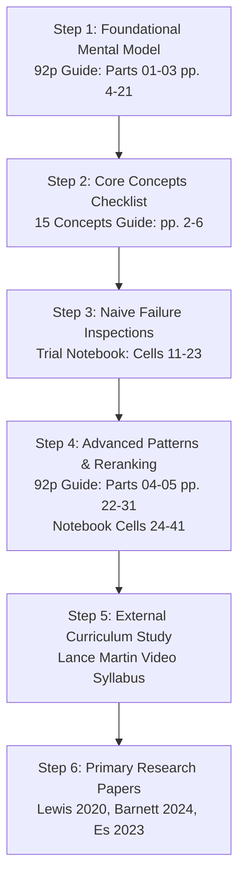

# DocuMind 1.0 — Phase-Wise Research Mapping & Gap Analysis

## A. Purpose & Methodology

### 1. Purpose
This document establishes the authoritative mapping between the archived research assets in `X:\Projects\Documind` and the authoritative Nine-Phase Engineering Plan of DocuMind 1.0. Its purpose is to evaluate what technical knowledge is already supported by existing materials, what knowledge is incomplete or missing, and what empirical experiments must be executed before making architectural or implementation decisions.

### 2. Methodology & Governance
- **Source Inventory Baseline:** All evaluations stem directly from the static inspection recorded in [`research/literature_notes/RESEARCH_SOURCE_INVENTORY.md`](file:///x:/Projects/Documind/research/literature_notes/RESEARCH_SOURCE_INVENTORY.md).
- **Master Plan Provenance & Scope:** The original file `Pasted text.txt` was **not located** in the local workspace. In strict accordance with project governance, no artificial replacement file was fabricated, nor is it claimed that the complete original master-plan file was found in `README.md`. The authoritative detailed nine-phase scope (numbered strictly Phase 0 through Phase 8) was supplied directly by the project owner in the project instructions and subsequent agent prompts, and is codified in [`README.md`](file:///x:/Projects/Documind/README.md) as the engineering roadmap:
  - Phase 0 — Project Foundation
  - Phase 1 — Literature Review and Baseline
  - Phase 2 — Document Ingestion and Chunking
  - Phase 3 — Embedding and Indexing
  - Phase 4 — Retrieval Optimization
  - Phase 5 — Generation and Grounding
  - Phase 6 — Advanced RAG
  - Phase 7 — Product Engineering
  - Phase 8 — Validation and Deployment
- **Four-Way Research & Implementation Separation:** To maintain strict engineering rigor, this document enforces clear boundaries between:
  1. *Knowledge to Acquire through Literature Review:* Theoretical concepts, algorithmic formulations, mathematical definitions, and published industry benchmarks.
  2. *Questions to Investigate:* Architectural trade-offs, open technical hypotheses, and failure modes requiring targeted analysis.
  3. *Controlled Experiments to Run:* Empirical benchmarks, parameter grid searches, component shootouts, and ablation studies producing measurable quantitative data.
  4. *Components Intended for Eventual Implementation:* Concrete pipeline components and system deliverables designed for the MVP and Version 1.0, developed only after empirical justification is established.
- **Assessment vs. Decision:** This document is an **audit and research assessment only**. It does not make speculative technology choices, pre-select libraries, create premature Architecture Decision Records (ADRs), or initiate application code. All architectural selections follow controlled experiments.
- **Zero-Cost & Privacy Constraints:** All architectural assessments, evaluations, and roadmap recommendations strictly adhere to:
  - ₹0 paid API usage (no paid OpenAI, Anthropic, Cohere, or proprietary cloud endpoints).
  - ₹0 paid cloud hosting or managed vector database subscriptions.
  - Exclusively local open-source models (via Ollama, Hugging Face, or ONNX) or genuinely free API tiers.
  - Absolute privacy protection: Zero external transmission of private datasets (such as the 25 candidate resumes in `resumes/`); private resumes are strictly prohibited from being used as external API benchmarks.

---

## B. Phase-by-Phase Research Mapping

### Phase 0 — Project Foundation
- **Phase Objective:** Establish the repository structure, governance framework, research archive, and initial technical audits.
- **Core Concepts to Understand:** Project directory conventions, Git tracking hygiene, sensitive data isolation, baseline verification, and reproducible documentation standards.
- **Relevant Archived Sources:**
  - `README.md` (Project vision, roadmap, and two-release milestones).
  - `.gitignore` (Path-specific protection rules for credentials, models, indexes, and private datasets).
  - `research/literature_notes/RESEARCH_SOURCE_INVENTORY.md` (Authoritative source inventory).
- **Exact Pages / Headings / Cells:**
  - `README.md`: Lines 1–107.
  - `.gitignore`: Lines 1–130.
  - `RESEARCH_SOURCE_INVENTORY.md`: Sections 1–5.
- **What is Adequately Covered:** Repository scaffolding (17 `.gitkeep` files), explicit two-release prioritization, Git ignore rules for private resumes and binaries, and cataloging of all initial materials.
- **What is Partially Covered:** Documentation workflows for subsequent phases (ADR templates and experiment logs are scaffolded in `docs/decisions/` and `docs/experiments/` but need concrete markdown templates).
- **What is Missing:** Baseline environment lockfile (`requirements.txt` or `pyproject.toml`) and formal CI testing configurations (intentionally deferred per Phase 0 rules).
- **Independent Literature Needed:** None.
- **Controlled Experiments Needed:** None.
- **Release Classification:** **MVP-Critical (Completed foundation).**

---

### Phase 1 — Literature Review & Baseline
- **Phase Objective:** Formulate the RAG problem mathematically and conceptually, review foundational literature, establish a naive baseline RAG pipeline, and construct a fixed evaluation question set.
- **Core Concepts to Understand:**
  - Foundational RAG architecture: Parametric memory vs. non-parametric retrieval loop.
  - Embeddings, token chunking, and similarity search fundamentals.
  - Failure taxonomy of naive RAG (coverage, fragmentation, grounding/hallucination).
  - Quantitative baseline metrics (Precision@K, Recall@K, Faithfulness).
- **Relevant Archived Sources:**
  - `research/technical_references/Everything-to-know-about-RAG.pdf`
  - `research/technical_references/BASWE-15-RAG-Concepts-Guide.pdf`
  - `research/tutorials/Agentic_Resume_Screening_RAG_Trial.ipynb`
  - `research/tutorials/RAG-Expert-Guide-BASWE.pdf`
- **Exact Pages / Headings / Cells:**
  - `Everything-to-know-about-RAG.pdf`: Part 01 (pp. 4–7, Token economics/context windows); Part 02 (pp. 8–13, RAG mental model); Part 03 (pp. 14–21, 7 building blocks); Part 08 (pp. 43–47, 7 failure points); Part 14 (pp. 76–77, Citations to Lewis et al. 2020, Barnett et al. 2024).
  - `BASWE-15-RAG-Concepts-Guide.pdf`: Concepts 01–06 (pp. 2–6, Chunking, embeddings, vector DBs, similarity search, top-k).
  - `Agentic_Resume_Screening_RAG_Trial.ipynb`: Cells 11–16 (Part 2, Basic naive RAG pipeline); Cells 17–23 (Part 3, Demonstrations of coverage, fragmentation, and grounding failures).
  - Lance Martin Video Course (Modules on RAG Overview & Indexing fundamentals).
- **What is Adequately Covered:** Conceptual mental model of RAG; plain-English explanation of why naive RAG fails; practical demonstrations of three failure types in the trial notebook.
- **What is Partially Covered:** Evaluation metrics (Ragas mentioned in 92-page guide p. 45 and p. 77, but without mathematical definitions or calculation formulas).
- **What is Missing:**
  - Primary peer-reviewed research papers (Lewis et al. 2020, Barnett et al. 2024 are cited as titles in Part 14, but raw papers are not in `research/papers/`).
  - Standardized evaluation benchmark suite:
    - *Full project benchmark:* Approximately 50–100 manually verified questions covering (1) single-document factual retrieval, (2) multi-chunk questions, (3) multi-document questions, (4) exact keyword queries, (5) semantic queries, (6) comparative and aggregation queries, and (7) unanswerable questions, annotated with relevant documents and supporting passages (strictly segregating private resumes from external exposure).
    - *MVP smoke-test subset:* Approximately 20–25 representative questions extracted from the full benchmark for rapid sanity-checking and regression testing during MVP development.
  - A zero-cost local LLM/embedding baseline implementation (notebook relies on paid OpenAI API).
- **Independent Literature Needed:** Primary study of Lewis et al. (2020) and Barnett et al. (2024) *Seven Failure Points*.
- **Controlled Experiments Needed:** Run an initial isolated baseline benchmark using a local model on CPU over the MVP smoke-test subset (~20–25 questions) drawn from the 50–100 question evaluation benchmark to measure baseline retrieval latency, recall, and hallucination rates.
- **Release Classification:** **MVP-Critical** (MVP requires naive baseline pipeline, the ~20–25 question smoke-test subset, and basic evaluation; full 50–100 question benchmark supports comprehensive validation across both MVP and DocuMind 1.0).

---

### Phase 2 — Document Ingestion & Chunking
- **Phase Objective:** Ingest unstructured PDF documents, preserve structural and page metadata, evaluate text extraction quality, and benchmark chunking strategies.
- **Core Concepts to Understand:**
  - PDF layout decomposition (multi-column text, headers, footers, tables, artifact filtering).
  - Chunking strategies: Fixed-character/token chunking, recursive-character splitting, document-structure-aware chunking, and semantic chunking.
  - Chunk size vs. overlap trade-offs: Boundary continuity vs. prompt dilution and index bloat.
  - Metadata preservation: Document ID, page numbers, section headers, chunk offsets.
  - Parent-child retrieval data models.
- **Relevant Archived Sources:**
  - `research/technical_references/Everything-to-know-about-RAG.pdf`
  - `research/technical_references/BASWE-15-RAG-Concepts-Guide.pdf`
  - `research/tutorials/Agentic_Resume_Screening_RAG_Trial.ipynb`
- **Exact Pages / Headings / Cells:**
  - `Everything-to-know-about-RAG.pdf`: Part 03 (pp. 15–16, Chunking concepts); Part 05 (pp. 28–29, Small-to-big chunk-to-parent expansion); Part 07 (pp. 38–40, Multimodal/table handling).
  - `BASWE-15-RAG-Concepts-Guide.pdf`: Concept 01 (p. 2, Chunking strategy); Concept 02 (p. 3, Chunk overlap: 10–20% trade-off); Concept 12 (p. 11, Small-to-big retrieval).
  - `Agentic_Resume_Screening_RAG_Trial.ipynb`: Cells 8–10 (Loading via `pypdf.PdfReader`); Cells 11–12 (`RecursiveCharacterTextSplitter(chunk_size=800, chunk_overlap=100)`); Cells 24–28 (`search_full_resumes` mapping chunk hits to full parent document).
- **What is Adequately Covered:** Conceptual trade-offs of chunk size and overlap; implementation of naive LangChain recursive splitting; small-to-big chunk-to-parent retrieval logic.
- **What is Partially Covered:** Overlap percentages (rules of thumb given as 10–20%, but without empirical validation data).
- **What is Missing:**
  - Robust PDF layout parsing: Existing sources use naive `pypdf` extraction, which drops structural formatting, merges multi-column resumes inappropriately, and fails on tables.
  - Comparative benchmark between extraction engines (e.g. `pypdf` vs. `PyMuPDF`/`fitz` vs. `pdfplumber`).
  - Semantic chunking algorithms (embedding distance boundary detection).
  - Rigorous parent-child data structures (hierarchical chunk trees preserving section metadata).
- **Independent Literature Needed:** Comparative studies on PDF document object models and semantic chunking boundaries.
- **Controlled Experiments Needed:**
  1. *Extraction Benchmark:* Compare PyMuPDF, pypdf, and pdfplumber on structured PDFs for speed and layout fidelity.
  2. *Chunking Grid-Search:* Benchmark chunk sizes (256, 512, 1024 tokens) and overlap ratios (0%, 10%, 20%) against fixed retrieval questions.
- **Release Classification:**
  - Basic PDF extraction, recursive chunking, page-number metadata: **MVP-Critical.**
  - Layout-aware extraction, comparative chunking experiments, parent-child retrieval: **Version 1.0.**
  - Dynamic semantic chunking: **Research / Experimental.**

---

### Phase 3 — Embedding & Indexing
- **Phase Objective:** Evaluate candidate embedding models and principal vector-index implementations across standardized technical dimensions, implement persistent vector indexing, and support robust index updates based on measured empirical results.
- **Core Concepts to Understand:**
  - Dense embedding spaces, vector dimensionality, cosine similarity, dot product, inner product math, and vector normalization requirements (L2 unit norm).
  - Open-source candidate embedding families: MiniLM (e.g. `all-MiniLM-L6-v2`), BGE (e.g. `bge-small-en-v1.5`), and E5 (e.g. `e5-small-v2`). All three candidates produce 384-dimensional embeddings; dimensionality is an intrinsic model property to record and verify against index configurations rather than a differentiating comparison variable among them.
  - Principal vector-index candidates: FAISS (file-serialized flat/IVF index) and Chroma (embedded persistent directory database); SQLite-VSS as an optional exploratory alternative only.
  - Evaluation criteria and candidate properties for embeddings:
    - Output embedding dimensionality: A verified model property to match against vector index structures (384 dimensions for all three candidates; not a differentiating comparison variable).
    - Maximum sequence length: Provisional candidate-specific limits that require verification against exact model cards and revisions:
      - `all-MiniLM-L6-v2`: 256 tokens.
      - `bge-small-en-v1.5`: 512 tokens.
      - `e5-small-v2`: 512 tokens.
    - Effective input context: Must be verified during implementation and benchmarking to account for tokenizer special tokens (`[CLS]`, `[SEP]`) and any required prefix formatting (e.g. `query: ` / `passage: ` prefixes for E5, task instructions for BGE).
    - Vector normalization requirements and metric compatibility (e.g. L2 unit norm for cosine distance equivalence via dot product).
    - Retrieval accuracy (MRR@10, Hit@K on evaluation queries).
    - CPU inference latency per chunk batch.
    - RAM / memory footprint during model load and batch encoding.
  - Evaluation dimensions for principal vector indexes:
    - Indexing throughput and build time across chunk scales (1,000 to 10,000+ chunks).
    - Search query latency (P50, P95) at scale.
    - Memory footprint (RAM overhead during search and indexing).
    - Disk persistence mechanism and index serialization/deserialization reliability.
    - Incremental document update, addition, and deletion lifecycle.
    - Metadata filtering capabilities and ease of local zero-cost deployment.
  - Index persistence, idempotent upsert mechanisms, and incremental document updates without full re-indexing.
- **Relevant Archived Sources:**
  - `research/technical_references/Everything-to-know-about-RAG.pdf`
  - `research/technical_references/BASWE-15-RAG-Concepts-Guide.pdf`
  - `research/legacy_references/RAG-based-Chatbot-main.zip`
  - `research/tutorials/Agentic_Resume_Screening_RAG_Trial.ipynb`
- **Exact Pages / Headings / Cells:**
  - `Everything-to-know-about-RAG.pdf`: Part 03 (pp. 16–18, Embeddings and vector spaces); Part 12 (pp. 60–62, Vector DB overview: Chroma, Pinecone, Qdrant, Weaviate, pgvector).
  - `BASWE-15-RAG-Concepts-Guide.pdf`: Concept 03 (p. 4, Embeddings); Concept 04 (p. 5, Vector databases); Concept 05 (p. 5, Similarity search math).
  - `RAG-based-Chatbot-main.zip`: `main.py` and `requirements.txt` (FAISS CPU index over `sentence-transformers==2.2.2`).
  - `Agentic_Resume_Screening_RAG_Trial.ipynb`: Cell 7 (`OpenAIEmbeddings(model="text-embedding-3-small")`); Cell 12 (`InMemoryVectorStore` with JSON file caching).
- **What is Adequately Covered:** High-level intuition of dense semantic vectors and vector indexing; naive in-memory indexing; legacy flat FAISS CPU usage.
- **What is Partially Covered:** Tooling landscape (the 92-page guide lists popular databases on pp. 60–62, but provides no quantitative latency, disk, or memory benchmarks).
- **What is Missing:**
  - Zero-cost, locally runnable embedding evaluation: The notebook relies exclusively on proprietary OpenAI embeddings.
  - Controlled comparative benchmarks across MiniLM, BGE, and E5 candidate models under strict zero-cost local constraints.
  - Controlled comparative evaluation of FAISS vs. Chroma as principal vector-index candidates for local persistence, query latency, and incremental updates (evaluating SQLite-VSS only as an optional exploratory alternative).
- **Independent Literature Needed:** MTEB (Massive Text Embedding Benchmark) leaderboard analysis for lightweight English retrieval models under 150M parameters.
- **Controlled Experiments Needed:**
  1. *Embedding Candidate Shootout:* Benchmark candidate models (`all-MiniLM-L6-v2`, `bge-small-en-v1.5`, `e5-small-v2` — all producing 384-dimensional embeddings) on CPU inference latency, memory consumption, vector normalization behavior, retrieval accuracy (MRR@10, Hit@K), and effective sequence limits (verifying provisional model-card limits: 256 tokens for MiniLM, 512 tokens for BGE and E5, accounting for special tokens and prefix formatting overhead) over the benchmark question set. Model selection follows measured results.
  2. *Principal Vector Index Comparison (FAISS vs. Chroma):* Benchmark FAISS and Chroma on indexing throughput, query latency, memory footprint, disk serialization reliability, and incremental update ergonomics under local zero-cost constraints. Index selection follows measured results. (SQLite-VSS may be evaluated as an optional exploratory alternative, not as a replacement for the FAISS/Chroma comparison).
- **Release Classification:**
  - Selection of single justified local embedding model and persistent vector index from controlled experiments, with persistent vector indexing and retrieval pipeline: **MVP-Critical.**
  - Comprehensive multi-family embedding ablation benchmarks, deep index scaling comparisons, and production-grade incremental index management lifecycle: **Version 1.0.**

---

### Phase 4 — Retrieval Optimization
- **Phase Objective:** Implement high-precision retrieval combining dense vector search, sparse keyword search, reranking, and context-budget management.
- **Core Concepts to Understand:**
  - Dense semantic retrieval (bi-encoders) vs. sparse lexical retrieval (BM25 / TF-IDF).
  - Hybrid search and Reciprocal Rank Fusion (RRF).
  - Two-stage retrieval: Over-fetching top candidates, followed by cross-encoder reranking.
  - Context budget optimization: Packing prompt context while preventing prompt dilution ("lost in the middle").
- **Relevant Archived Sources:**
  - `research/technical_references/Everything-to-know-about-RAG.pdf`
  - `research/technical_references/BASWE-15-RAG-Concepts-Guide.pdf`
  - `research/tutorials/Agentic_Resume_Screening_RAG_Trial.ipynb`
  - Lance Martin Video Course (Modules on Query Translation, RRF, and Reranking).
- **Exact Pages / Headings / Cells:**
  - `Everything-to-know-about-RAG.pdf`: Part 04 (pp. 22–25, Hybrid RAG: BM25 + Vector search, RRF scoring); Part 05 (pp. 30–31, Reranking pass); Part 14 (p. 76, ColBERT citation).
  - `BASWE-15-RAG-Concepts-Guide.pdf`: Concept 06 (p. 6, Top-k limits); Concept 07 (p. 7, Hybrid search); Concept 11 (p. 10, Reranking).
  - `Agentic_Resume_Screening_RAG_Trial.ipynb`: Cells 36–41 (Part 6, LLM structured reranker over-fetching 15 chunks down to 4).
- **What is Adequately Covered:** Intuition behind hybrid retrieval (handling rare keywords/acronyms that embeddings miss); the necessity of reranking to fix cosine similarity proxy errors.
- **What is Partially Covered:** LLM-as-reranker in the trial notebook (demonstrates reordering, but using full LLM structured generation for reranking is computationally prohibitive and costly).
- **What is Missing:**
  - Dedicated candidate cross-encoder models (e.g. `bge-reranker-base` or `ms-marco-MiniLM-L-6-v2`) executing locally on CPU.
  - Concrete Reciprocal Rank Fusion (RRF) Python implementation formula ($RRF\_Score(d) = \sum \frac{1}{k + r(d)}$).
  - BM25 integration with tokenizers that match the dense retriever.
  - Context-budget packing algorithms that respect token limits without truncation.
- **Independent Literature Needed:** Cormack et al. (2009) *Reciprocal Rank Fusion*; Nogueira & Cho (2019) *Passage Re-ranking with BERT*.
- **Controlled Experiments Needed:**
  1. *Reranker Performance & Latency:* Compare dense-only vs. BM25-only vs. Hybrid RRF vs. Hybrid + Cross-Encoder on NDCG@10 and P95 latency.
  2. *Context-Budget Window Test:* Measure answer accuracy as context length scales from 1,000 to 8,000 tokens to identify context dilution thresholds.
- **Release Classification:**
  - Top-K dense retrieval with context window budget cap: **MVP-Critical.**
  - BM25 sparse search, Hybrid RRF, and local Cross-Encoder reranking: **Version 1.0.**
  - ColBERT late-interaction token retrieval: **Research / Experimental.**

---

### Phase 5 — Generation & Grounding
- **Phase Objective:** Generate accurate, grounded responses with inline verifiable citations, handle unanswerable queries gracefully, and eliminate hallucinations.
- **Core Concepts to Understand:**
  - System prompt engineering for factual grounding ("Answer strictly using provided context").
  - Inline source and page citation attribution.
  - Negative constraint handling (detecting unstated information and refusing to hallucinate).
  - Local inference options (Ollama with Llama 3 / Mistral / Qwen) vs. free hosted tiers.
  - Claim/evidence validation and structured output verification.
- **Relevant Archived Sources:**
  - `research/technical_references/Everything-to-know-about-RAG.pdf`
  - `research/technical_references/BASWE-15-RAG-Concepts-Guide.pdf`
  - `research/tutorials/Agentic_Resume_Screening_RAG_Trial.ipynb`
- **Exact Pages / Headings / Cells:**
  - `Everything-to-know-about-RAG.pdf`: Part 03 (pp. 19–21, Prompt injection and generation); Part 05 (p. 27, Grounding constraints); Part 08 (pp. 44–46, Hallucination detection).
  - `BASWE-15-RAG-Concepts-Guide.pdf`: Concept 14 (p. 12, Grounding and citations: verifiable claims).
  - `Agentic_Resume_Screening_RAG_Trial.ipynb`: Cells 29–35 (Part 5, Pydantic schemas `CandidateAssessment` and `ScreeningReport` with explicit `unknowns` attribute).
- **What is Adequately Covered:** Prompting strategies for unanswerable questions; using Pydantic structured output to force the model to declare missing facts rather than guessing.
- **What is Partially Covered:** Citations (the concepts are advocated on p. 12 of the 14-page guide, but exact parsing and inline bracket formatting `[Doc, p. X]` is not formalized).
- **What is Missing:**
  - Zero-cost local LLM evaluation: Running structured outputs via local Ollama models (e.g. `llama3.2:3b` or `qwen2.5:3b`) without commercial APIs.
  - Automated citation verification (checking whether the cited span actually entails the generated claim).
  - Formal prompt templates for general-purpose RAG (independent of the resume screening domain).
- **Independent Literature Needed:** Min et al. (2023) *FActScore: Fine-grained Atomic Evaluation of Factual Precision in Long Form Text Generation*.
- **Controlled Experiments Needed:**
  1. *Unanswerable Query Benchmark:* Test 10 queries where the answer does not exist in the ingested documents; evaluate refusal rate vs. hallucination rate across candidate prompts.
  2. *Citation Entailment Check:* Evaluate whether local 3B–7B models reliably produce accurate inline page citations.
- **Release Classification:**
  - Grounded prompt template, inline page citations, and unanswerable query refusal: **MVP-Critical.**
  - Local LLM comparisons (Llama vs. Qwen), automated claim/evidence validation: **Version 1.0.**
  - Formal citation entailment verifier sub-pipelines: **Research / Experimental.**

---

### Phase 6 — Advanced RAG
- **Phase Objective:** Implement advanced query translation, multi-step retrieval, corrective loops, and multi-document synthesis.
- **Core Concepts to Understand:**
  - Query rewriting (disambiguating conversational references and typos).
  - Multi-query expansion and sub-query decomposition.
  - Hypothetical Document Embeddings (HyDE).
  - Adaptive & Corrective RAG (Self-RAG, CRAG): Inspecting retrieval quality and conditionally falling back or expanding queries.
  - Multi-document reasoning and cross-document entity alignment.
  - Conversational session memory across turns.
- **Relevant Archived Sources:**
  - `research/technical_references/Everything-to-know-about-RAG.pdf`
  - `research/technical_references/BASWE-15-RAG-Concepts-Guide.pdf`
  - `research/tutorials/Agentic_Resume_Screening_RAG_Trial.ipynb`
  - Lance Martin Video Course (Modules on Query Translation, Sub-queries, and Corrective RAG).
- **Exact Pages / Headings / Cells:**
  - `Everything-to-know-about-RAG.pdf`: Part 05 (pp. 26–27, Query rewriting and HyDE); Part 06 (pp. 32–37, Agents, multi-step flows, GraphRAG); Part 14 (pp. 76–77, Citations to Gao et al. 2022 HyDE, Asai et al. 2023 Self-RAG).
  - `BASWE-15-RAG-Concepts-Guide.pdf`: Concept 09 (p. 8, Query rewriting); Concept 10 (p. 9, HyDE); Concept 13 (p. 11, Contextual retrieval).
  - `Agentic_Resume_Screening_RAG_Trial.ipynb`: Cell 35 (Markdown mentioning adaptive strategy and corrective checks; **never implemented in code**).
- **What is Adequately Covered:** High-level conceptual descriptions of HyDE, query rewriting, and agentic multi-step retrieval.
- **What is Partially Covered:** Query rewriting intuition (guides explain why it helps, but provide no prompt templates or evaluation of latency overhead).
- **What is Missing:**
  - Concrete implementation code: The trial notebook explicitly promised an agent and self-correcting retrieval in Cell 35, but stopped before implementing them.
  - Algorithmic formulation of CRAG / Self-RAG evaluation loops.
  - Multi-document aggregation architectures that prevent context blowout.
  - Conversational memory state management.
- **Independent Literature Needed:** Gao et al. (2022) *HyDE*; Yan et al. (2024) *Corrective Retrieval Augmented Generation (CRAG)*; Asai et al. (2023) *Self-RAG*.
- **Controlled Experiments Needed:**
  1. *Query Expansion Ablation:* Measure retrieval recall improvement of Multi-Query and HyDE vs. baseline, offset against the 2x–4x increase in embedding latency.
  2. *Corrective Routing Test:* Test retrieval quality evaluation on ambiguous queries to verify fallback triggering.
- **Release Classification:**
  - Basic query rewriting and multi-document aggregation: **Version 1.0.**
  - HyDE, CRAG, Self-RAG, and Conversational Memory: **Research / Experimental.**
  - *(None are MVP-Critical; deferred to avoid premature complexity).*

---

### Phase 7 — Product Engineering
- **Phase Objective:** Construct an operational, modular application with a FastAPI service layer, interactive Streamlit interface, document collection management, and citation viewer.
- **Core Concepts to Understand:**
  - Decoupled API architecture (FastAPI router endpoints for upload, index, query, health).
  - Reactive GUI state management in Streamlit (session state, chat stream, file upload, citation modal/sidebar).
  - Document collection lifecycle (creation, deletion, metadata browsing).
  - Conversational history display.
  - Criteria for adopting a React frontend (strictly conditional on performance/UX justification).
- **Relevant Archived Sources:**
  - `research/legacy_references/RAG-based-Chatbot-main.zip`
  - `research/legacy_references/RAG MC.pdf`
  - `research/technical_references/Everything-to-know-about-RAG.pdf`
- **Exact Pages / Headings / Cells:**
  - `RAG-based-Chatbot-main.zip`: `GUI.py` (Streamlit web interface, chat history rendering); `cli.py` (Command-line loop); `main.py` (Launcher menu).
  - `RAG MC.pdf`: Whiteboard diagram detailing Streamlit UI, AWS hosting, and user session concepts.
  - `Everything-to-know-about-RAG.pdf`: Part 12 (pp. 64–66, Frameworks and UI tools: Streamlit, Chainlit).
- **What is Adequately Covered:** Streamlit chat interface structure (inspected in legacy `GUI.py`); basic file upload patterns.
- **What is Partially Covered:** Document collection management (legacy project uses a single flat file `knowledge.txt`; multi-document collection switching is absent).
- **What is Missing:**
  - Modular FastAPI backend specification (request/response schemas, streaming endpoints).
  - Interactive citation viewer (clicking a citation to view the underlying extracted PDF page snippet).
  - Decoupled service layer architecture adhering to DocuMind's zero-dependency baseline.
- **Independent Literature Needed:** FastAPI and Streamlit official production design guidelines.
- **Controlled Experiments Needed:**
  1. *Streamlit vs. API Latency:* Benchmark direct Streamlit component execution vs. Streamlit-to-FastAPI HTTP streaming.
- **Release Classification:**
  - Functional Streamlit interface with document upload, chat, and citation display: **MVP-Critical.**
  - Decoupled FastAPI backend, multi-collection management, conversation history: **Version 1.0.**
  - React/TypeScript frontend: **Research / Experimental (Strictly conditional).**

---

### Phase 8 — Validation & Deployment
- **Phase Objective:** Execute comprehensive quantitative evaluation, conduct ablation studies across pipeline components, run failure tests, profile resource usage, and package for reproducible deployment.
- **Core Concepts to Understand:**
  - Retrieval metrics: Precision@K, Recall@K, Mean Reciprocal Rank (MRR), NDCG.
  - Generation metrics: Faithfulness, Answer Relevance, Context Precision, Hallucination Rate.
  - Automated RAG evaluation frameworks: Ragas, TruLens, DeepEval.
  - Component ablation methodology (measuring the exact contribution of chunk size, hybrid search, and reranking).
  - Latency and memory profiling on CPU environments.
  - Containerized deployment (Docker, Docker Compose) under zero-cost constraints.
- **Relevant Archived Sources:**
  - `research/technical_references/Everything-to-know-about-RAG.pdf`
  - `research/technical_references/BASWE-15-RAG-Concepts-Guide.pdf`
- **Exact Pages / Headings / Cells:**
  - `Everything-to-know-about-RAG.pdf`: Part 08 (pp. 43–47, Testing and fixing RAG: 7 failure points, Ragas metrics); Part 09 (pp. 48–50, Real-world latency, cost, and safety); Part 14 (p. 77, Citations to Es et al. 2023 Ragas, Barnett et al. 2024 Seven Failure Points).
  - `BASWE-15-RAG-Concepts-Guide.pdf`: Concept 15 (p. 13, Retrieval evaluation).
- **What is Adequately Covered:** Conceptual overview of Ragas metrics (Faithfulness, Answer Relevance); high-level identification of production bottlenecks.
- **What is Partially Covered:** Benchmark evaluation sets: The 14-page guide emphasizes the value of curated evaluation (*"Fifty hand written question and source pairs beat any off the shelf benchmark"*, p. 13), aligning with DocuMind's requirement for a 50–100 manually verified question benchmark, but provides no actual dataset.
- **What is Missing:**
  - Standardized full project evaluation benchmark: Approximately 50–100 manually verified questions covering (1) single-document factual retrieval, (2) multi-chunk questions, (3) multi-document questions, (4) exact keyword queries, (5) semantic queries, (6) comparative and aggregation queries, and (7) unanswerable questions, annotated with relevant documents and supporting passages (strictly segregating private resumes from external exposure).
  - MVP smoke-test subset: Approximately 20–25 representative questions extracted from the full benchmark for rapid sanity-checking and regression testing during iterative MVP development.
  - Python evaluation harnesses implementing standard metric formulas (Precision@K, Recall@K, MRR, Faithfulness).
  - Ablation matrix test runners (systematically swapping chunking strategies, embedding candidates, and retrieval combinations).
  - Resource profiling scripts (RAM usage, CPU utilization, P50/P95 latency tracking).
  - Docker containerization files and reproducible deployment scripts.
- **Independent Literature Needed:** Es et al. (2023) *Ragas: Automated Evaluation of Retrieval Augmented Generation*.
- **Controlled Experiments Needed:**
  1. *Full Component Ablation:* Measure baseline vs. +BM25 vs. +RRF vs. +Reranker on the full 50–100 question project evaluation benchmark (using the 20–25 question smoke-test subset for rapid iteration).
  2. *Hardware Resource Profiling:* Profile memory footprint and generation throughput on an 8GB/16GB RAM laptop without GPU acceleration.
- **Release Classification:**
  - MVP smoke-test subset (~20–25 questions), manual/scripted evaluation runner, and basic failure testing: **MVP-Critical.**
  - Full project benchmark (~50–100 annotated questions), full automated evaluation framework, comprehensive component ablation matrix, resource profiling, and Docker deployment: **Version 1.0.**

---

## C. Research Gap Register

The following register details the identified knowledge and empirical gaps, ranked by urgency across project releases:

| Gap ID | Topic | Relevant Phase | Current Coverage | Missing Knowledge | Priority | Proposed Research Action |
| :---: | :--- | :---: | :--- | :--- | :---: | :--- |
| **GAP-01** | PDF Parsing & Extraction Quality | Phase 2 | Basic `pypdf` in notebook | Layout awareness, multi-column handling, table extraction | **MVP-Critical** | Benchmark PyMuPDF vs. pypdf on structured sample PDFs. |
| **GAP-02** | Page-Level Metadata & Source Tracking | Phase 2 | File-level metadata in notebook | Invariant page-number and bounding-box preservation across chunks | **MVP-Critical** | Develop chunk metadata schema preserving `doc_id`, `page_number`, `chunk_id`. |
| **GAP-03** | Chunk Size & Overlap Trade-Offs | Phase 2 | 800/100 rule of thumb in sources | Empirical evidence of boundary cutoffs and prompt dilution | **MVP-Critical** | Execute grid search (256, 512, 1024 tokens; 0%, 10%, 20% overlap) against evaluation QA. |
| **GAP-04** | Zero-Cost Local Embedding Model Comparison | Phase 3 | OpenAI proprietary API in notebook | Comparative CPU latency, effective sequence length / prefix overhead, normalization, memory footprint, and MRR across candidate families (MiniLM, BGE, E5; all 384-dim) | **MVP-Critical** | Conduct controlled experiments comparing candidate embedding families (MiniLM, BGE, E5) on CPU latency, memory footprint, retrieval accuracy (MRR@10, Hit@K), normalization behavior, and effective input sequence limits (verifying model-card limits: MiniLM 256 tokens, BGE 512 tokens, E5 512 tokens, plus prefix overhead); select model based on measured results. |
| **GAP-05** | Persistent Vector Indexing (FAISS vs. Chroma) | Phase 3 | In-memory JSON cache in notebook; flat FAISS CPU index in legacy zip | Controlled comparison of principal index candidates (FAISS vs. Chroma) on indexing speed, search latency, memory footprint, disk persistence, and incremental updates; SQLite-VSS as optional exploratory alternative | **MVP-Critical** | Conduct controlled persistence and latency experiments comparing FAISS and Chroma (evaluating SQLite-VSS only as an optional exploratory alternative); select primary index based on measured empirical data. |
| **GAP-06** | Top-K Retrieval & Relevance Thresholds | Phase 4 | Naive k=4 in notebook; conceptual p. 6 | Impact of score cutoffs on precision vs. silence on irrelevant queries | **MVP-Critical** | Test distance thresholds (e.g. cosine distance < 0.3) on out-of-domain queries. |
| **GAP-07** | Grounded Generation & Citations | Phase 5 | Pydantic schema in notebook; concept p. 12 | Standardized inline bracketed citation formatting `[Doc, p. X]` | **MVP-Critical** | Design and validate prompt template enforcing strict context-only answers with citations. |
| **GAP-08** | Unanswerable Question Handling | Phase 5 | `unknowns` field in notebook schema | Consistent refusal prompting across open-source local LLMs | **MVP-Critical** | Benchmark refusal accuracy of local 3B/7B models on 10 unanswerable test queries. |
| **GAP-09** | Evaluation Benchmark Suite (Full Benchmark & MVP Subset) | Phase 1, 8 | 3 failure queries in notebook | Full project benchmark (50–100 manually verified questions with passage annotations across 7 query types: single-doc factual, multi-chunk, multi-doc, exact keyword, semantic, comparative/aggregation, unanswerable) and MVP smoke-test subset (~20–25 questions); strict prohibition on private resume exposure | **MVP-Critical** | Author and annotate a 50–100 question ground-truth benchmark on sanitized public documents across all 7 query categories, isolating an initial 20–25 question subset for MVP smoke-testing. |
| **GAP-10** | Dense vs. BM25 & Hybrid Fusion (RRF) | Phase 4 | High-level concept (pp. 22–25) | Exact Python implementation of BM25 + RRF ranking formulas | **Version 1.0** | Implement zero-dependency BM25 and evaluate RRF score fusion on technical vocabularies. |
| **GAP-11** | Local Cross-Encoder Reranking | Phase 4 | Slow LLM reranker in notebook (Cell 37) | Fast, local cross-encoder models (e.g. `bge-reranker-base`, `ms-marco-MiniLM-L-6-v2`) on CPU | **Version 1.0** | Benchmark candidate cross-encoder inference latency vs. precision gain over top-15 candidates. |
| **GAP-12** | Context Construction & Budget Optimization | Phase 4, 5 | Context window "desk" metaphor (p. 5) | Context packing algorithms and "lost-in-the-middle" mitigation | **Version 1.0** | Implement token-budget manager packing reranked chunks up to context limit. |
| **GAP-13** | Automated Citation Verification | Phase 5 | None | Algorithmic entailment check validating that citation text supports claim | **Version 1.0** | Research NLI (Natural Language Inference) models or secondary validation passes. |
| **GAP-14** | Multi-Document Reasoning | Phase 6 | Conceptual mention (Part 6) | Query decomposition and synthesis across disparate documents | **Version 1.0** | Develop sub-query mapping and synthesis pipeline for multi-document comparisons. |
| **GAP-15** | Query Transformation (Expansion / Rewriting) | Phase 6 | Conceptual mention (p. 26) | Prompt templates for standalone query rewriting and multi-query expansion | **Version 1.0** | Evaluate query rewriting accuracy and latency overhead using local models. |
| **GAP-16** | Performance & Resource Profiling | Phase 8 | Conceptual mention (pp. 48–50) | Memory footprint, P95 retrieval latency, and tokens/sec on CPU hardware | **Version 1.0** | Build automated profiling harness tracking memory and wall-clock times per component. |
| **GAP-17** | Decoupled Architecture & Deployment | Phase 7, 8 | Monolithic Streamlit in legacy zip | Production FastAPI backend, Docker containerization, health checks | **Version 1.0** | Create Dockerfile and docker-compose configurations targeting CPU environments. |
| **GAP-18** | Adaptive / Corrective RAG (CRAG, Self-RAG) | Phase 6 | Mentioned in notebook Cell 35 (unimplemented) | Self-evaluating retrieval loops with dynamic fallback routing | **Research / Exp.** | Review Yan et al. (2024) and implement experimental retrieval-evaluation routing. |
| **GAP-19** | Semantic Chunking | Phase 2 | Mentioned in 92-page guide | Adaptive splitting based on embedding cosine distance shifts | **Research / Exp.** | Test semantic chunker latency and compare chunk cohesion against recursive splitting. |
| **GAP-20** | Parent-Child Hierarchical Retrieval | Phase 2, 4 | Implemented naively in notebook Cell 25 | Formal document store linking leaf chunks to parent paragraphs | **Research / Exp.** | Evaluate parent-child index retrieval recall vs. plain chunk retrieval. |
| **GAP-21** | HyDE (Hypothetical Document Embeddings) | Phase 6 | Concept p. 27; Concept 10 p. 9 | LLM hallucinated document generation prior to dense search | **Research / Exp.** | Benchmark HyDE retrieval on ambiguous questions against raw vector search. |
| **GAP-22** | Conversational Memory State Management | Phase 6 | Concept p. 34 | Multi-turn query reformulation without context drift | **Research / Exp.** | Evaluate sliding-window vs. summarization memory architectures. |

---

## D. Prioritized Research Backlog

### 1. Before MVP Implementation (Immediate Prerequisites)
1. **Literature Synthesis on Baseline Architectures:** Acquire and review Lewis et al. (2020) to formally ground the baseline RAG retrieval-generation pipeline.
   - *Decision Informed:* Establishes mathematical formulation and baseline architectural boundaries for Phase 1.
2. **Local PDF Text Extraction Spike:** Conduct an isolated code spike comparing `pypdf` and `PyMuPDF` on multi-page PDF documents.
   - *Decision Informed:* Selects the primary parsing engine for Phase 2 based on speed, layout preservation, and page-metadata reliability.
3. **Candidate Embedding Model Comparison (Zero-Cost):** Profile candidate families (MiniLM, BGE, E5 — all producing 384-dimensional embeddings) locally on CPU across vector normalization requirements, inference latency, memory footprint, retrieval accuracy (MRR@10), and provisional sequence limits (verifying model cards: MiniLM at 256 tokens, BGE and E5 at 512 tokens, including prefix token overhead).
   - *Decision Informed:* Evaluates candidate models through controlled experiments to select the single embedding model for MVP Phase 3 based on measured empirical results.
4. **Principal Vector Index Comparison (FAISS vs. Chroma):** Compare FAISS and Chroma on indexing throughput, query latency, memory usage, disk persistence mechanism, and incremental update support, evaluating SQLite-VSS only as an optional exploratory alternative.
   - *Decision Informed:* Evaluates principal vector index candidates to select the persistent storage engine for Phase 3 based on measured empirical data.
5. **Evaluation Benchmark Construction:** Author a full project benchmark of approximately 50–100 manually verified questions with document and passage annotations across 7 query categories (single-document factual, multi-chunk, multi-document, exact keyword, semantic, comparative/aggregation, and unanswerable), extracting an initial ~20–25 question smoke-test subset for rapid MVP validation while strictly segregating private resumes.
   - *Decision Informed:* Establishes the objective benchmark required to measure all subsequent pipeline changes and prevent regression across both releases.

### 2. During MVP Development (Refinements)
1. **Chunk Size & Overlap Grid Search:** Run 256, 512, and 1024-token chunking against the fixed evaluation set.
   - *Decision Informed:* Fixes default chunking parameters in Phase 2.
2. **Grounded Citation Prompting & Negative Refusal:** Formulate prompt templates for local LLMs enforcing bracketed citations and graceful refusal on unstated facts.
   - *Decision Informed:* Directs prompt engineering and schema validation in Phase 5.
3. **Streamlit UI Citation Layout:** Prototype split-pane or expandable citation views in Streamlit.
   - *Decision Informed:* Determines frontend user experience for source verification in Phase 7.

### 3. Before Version 1.0 (Advanced Optimizations)
1. **Hybrid Retrieval (BM25 + RRF) Formulation:** Study Cormack et al. (2009) and implement Reciprocal Rank Fusion.
   - *Decision Informed:* Upgrades vector retrieval to hybrid search in Phase 4.
2. **Cross-Encoder Reranking Study:** Evaluate candidate cross-encoder models (e.g. `bge-reranker-base`, `ms-marco-MiniLM-L-6-v2`) on inference latency and precision gains.
   - *Decision Informed:* Determines whether to insert a reranking stage in Phase 4 based on measured results.
3. **Automated Evaluation Framework (Ragas):** Review Es et al. (2023) and integrate automated metric scoring.
   - *Decision Informed:* Replaces manual evaluation with reproducible metrics in Phase 8.
4. **FastAPI Decoupled Service Architecture:** Design REST endpoints for ingest, query, and streaming responses.
   - *Decision Informed:* Restructures product architecture in Phase 7.

### 4. Optional Research Experiments (Deferred Explorations)
1. **HyDE Feasibility:** Evaluate whether generating hypothetical passages improves recall on ambiguous queries.
2. **Corrective RAG (CRAG) Loops:** Explore active retrieval evaluation with fallback web/secondary search.
3. **Semantic Chunking:** Assess embedding-shift chunking vs. recursive chunking trade-offs.

---

## E. Recommended Reading Order for Engineers

To build comprehensive competence efficiently without reading all 92 pages upfront, engineers should follow this targeted, phase-aligned sequence:

1. **Step 1 — Foundational Mental Model (30 mins):**
   - Read [`research/technical_references/Everything-to-know-about-RAG.pdf`](file:///x:/Projects/Documind/research/technical_references/Everything-to-know-about-RAG.pdf), **Parts 01, 02, and 03 (pp. 4–21)**.
   - *Goal:* Internalize token context windows ("the LLM desk"), parametric vs. retrieved knowledge, and the 7 building blocks.
2. **Step 2 — Core Concepts Checklist (15 mins):**
   - Review [`research/technical_references/BASWE-15-RAG-Concepts-Guide.pdf`](file:///x:/Projects/Documind/research/technical_references/BASWE-15-RAG-Concepts-Guide.pdf), **Concepts 01–06 (pp. 2–6)**.
   - *Goal:* Memorize the mechanics of chunking boundaries, overlap trade-offs, and similarity search.
3. **Step 3 — Inspect Failure Modes (30 mins):**
   - Statically inspect [`research/tutorials/Agentic_Resume_Screening_RAG_Trial.ipynb`](file:///x:/Projects/Documind/research/tutorials/Agentic_Resume_Screening_RAG_Trial.ipynb), **Cells 11–23 (Parts 2 & 3)**.
   - *Goal:* See exact code and outputs demonstrating coverage, fragmentation, and hallucination failures.
4. **Step 4 — Study Partial Solutions & Advanced Patterns (45 mins):**
   - Read `Everything-to-know-about-RAG.pdf`, **Parts 04 & 05 (pp. 22–31)** (Hybrid RAG, Small-to-big retrieval, Reranking).
   - Inspect `Agentic_Resume_Screening_RAG_Trial.ipynb`, **Cells 24–41 (Parts 4, 5 & 6)** (Small-to-big full resume retrieval, Pydantic grounding schemas, and reranker pass).
5. **Step 5 — External Video Curriculum Study (Optional, 1–2 hours):**
   - Review Lance Martin's *RAG From Scratch* syllabus (`https://www.youtube.com/watch?v=sVcwVQRHIc8`) focusing on Query Translation and Indexing.
6. **Step 6 — Primary Research Literature (Prior to Phase 1/Phase 4 decisions):**
   - Read primary papers once downloaded: Lewis et al. (2020) for foundational baseline; Barnett et al. (2024) for failure analysis; Es et al. (2023) for Ragas metrics.

---

## F. Source Limitations & Unresolved Questions

1. **Absence of Local Primary Scientific Papers:**
   - While `Everything-to-know-about-RAG.pdf` (pp. 76–77) cites seminal literature (Lewis 2020, Gao 2022, Es 2023), **no primary research papers currently exist in `research/papers/`**. Citations in an educational guide are not equivalent to having local primary literature.
2. **Pedagogical vs. Scientific Nature of Educational Guides:**
   - The BASWE guides are high-quality educational field manuals, but they are **not peer-reviewed research**. They offer qualitative heuristics (e.g. "10–20% overlap") rather than empirical benchmark tables.
3. **Framework & Commercial API Bias:**
   - The existing tutorial notebook and Lance Martin video series rely heavily on LangChain abstractions and proprietary OpenAI APIs. DocuMind's zero-cost constraint requires building modular, independent Python components backed by local open-source models.
4. **Unimplemented Capabilities in Trial Notebook:**
   - The notebook promises agentic loops, self-correction, and query routing in Cell 35, but abruptly terminates at Cell 41. **No agentic or self-correcting RAG code exists in the repository.**
5. **Unresolved Technical Questions:**
   - *Extraction Fidelity:* Can open-source Python PDF parsers extract clean text from complex layouts on CPU in under 500ms per page? *(Unresolved; requires Phase 2 spike).*
   - *Local Model Factual Refusal:* Can local 3B–7B parameter models (e.g. Llama-3.2-3B or Qwen-2.5-3B) consistently refuse to answer unanswerable queries without hallucinatory drift? *(Unresolved; requires Phase 5 prompt benchmark).*
   - *Zero-Cost Index Scalability & Trade-offs:* What are the comparative disk, memory, and latency trade-offs between FAISS (file-serialized) and Chroma (embedded directory database) when scaling to thousands of chunks on standard development hardware? *(Unresolved; requires Phase 3 controlled indexing experiments).*

---

## G. Transition to Phase 1

Before formal Phase 1 (Literature Review and Baseline) implementation can begin, the following administrative and research prerequisites must be satisfied:

1. **Project Owner Review & Approval:** The source inventory (`RESEARCH_SOURCE_INVENTORY.md`) and this mapping document (`PHASE_WISE_RESEARCH_MAPPING.md`) must be formally reviewed and accepted.
2. **Primary Literature Acquisition:** Download raw PDFs of foundational papers (Lewis et al. 2020, Barnett et al. 2024) into `research/papers/`.
3. **Local Runtime Verification:** Confirm local installation of a zero-cost model runtime (e.g. Ollama with a verified lightweight model) to ensure zero dependence on proprietary commercial APIs.
4. **Benchmark Corpus Preparation:** Select and sanitize a clean, public document collection (ensuring private candidate resumes are strictly segregated and never transmitted externally) to support the ~50–100 question project benchmark and ~20–25 question MVP smoke-test subset.

> [!CAUTION]
> **Stop Condition Enforced:** Do not write application code, create configuration files, install dependencies, or select specific models until Phase 0 is formally closed by project governance.
